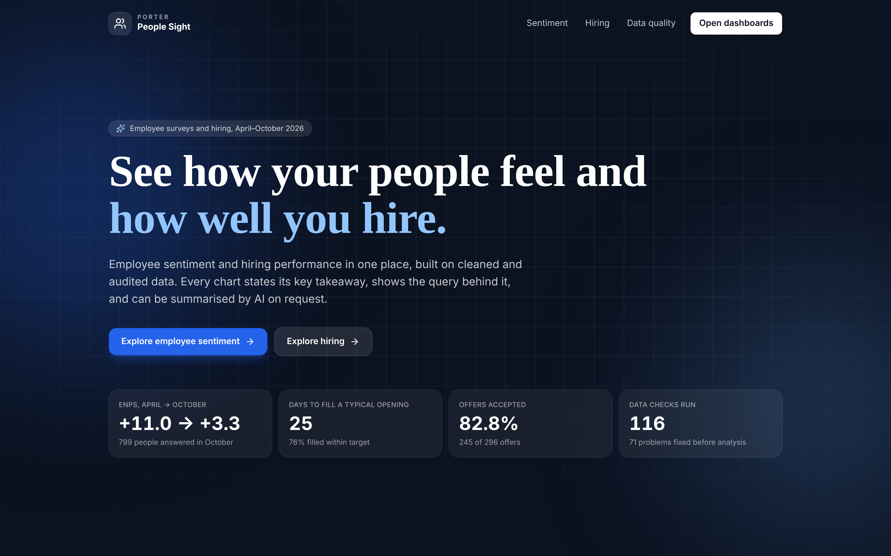
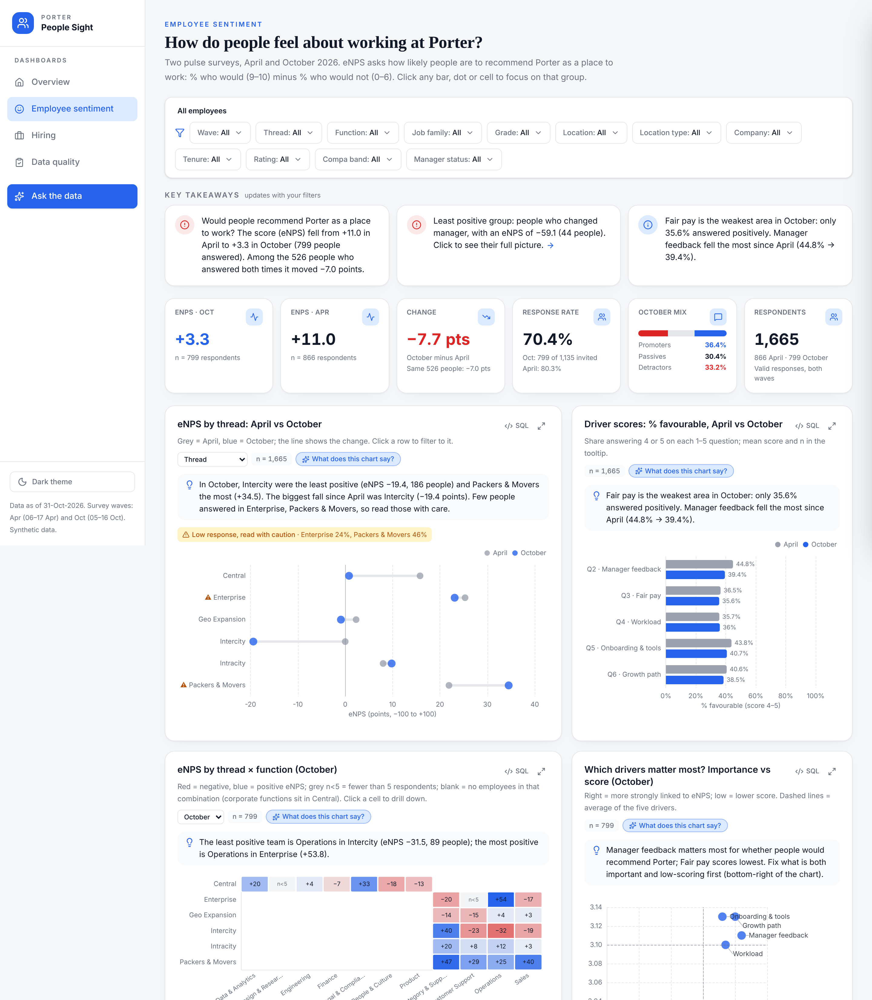
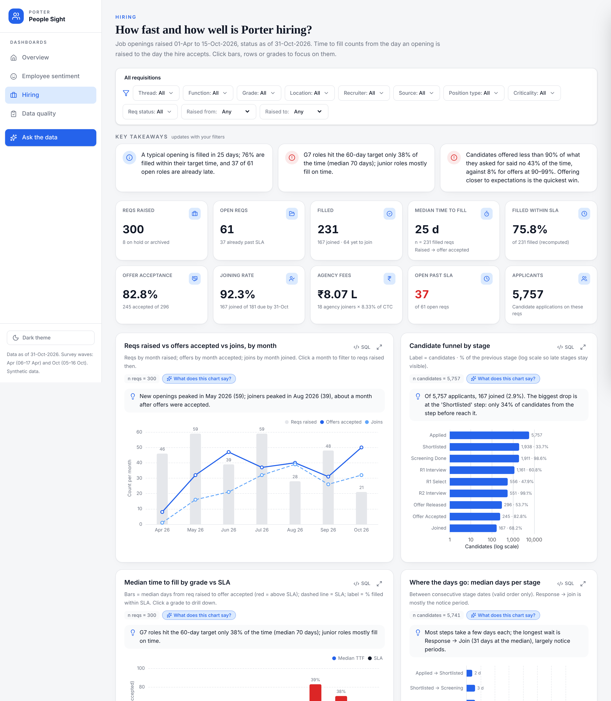
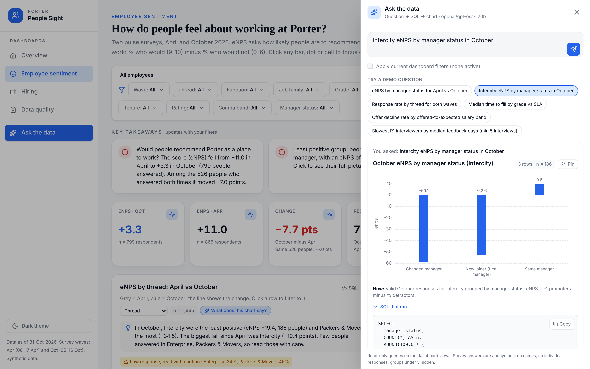
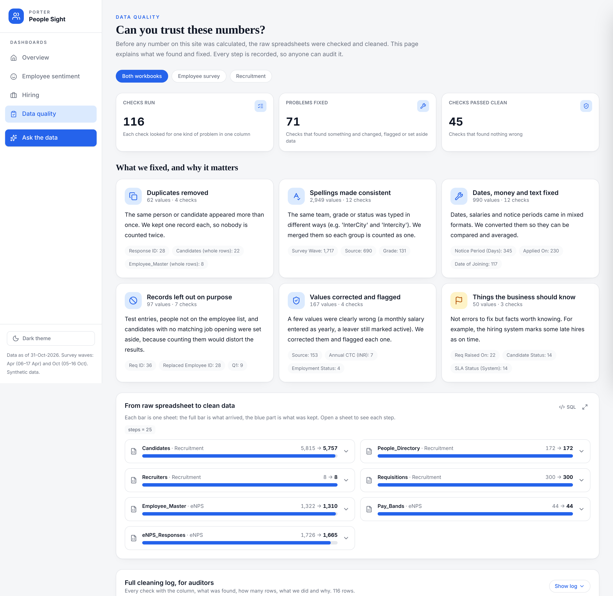

# People Sight

**People analytics for Porter: how employees feel and how well we hire.**

People Sight brings the April and October 2026 employee pulse surveys and the requisition-to-joining hiring data into
one place. Every chart states what it shows in a sentence, every number can be traced to the query behind it, and
anyone can ask their own questions of the data.



| | |
|---|---|
| **Dashboards** | [Overview](https://people-sight.onrender.com) · [Employee sentiment](https://people-sight.onrender.com/sentiment) · [Hiring](https://people-sight.onrender.com/hiring) · [Data quality](https://people-sight.onrender.com/data-quality) |
| **Insights** | [Findings and recommendations](docs/insights.md) · [Leadership deck](docs/Porter_People_Insights.pptx) · [Data quality note](docs/data_quality.md) |
| **Data** | Sample dataset, as of 31-Oct-2026 |

---

## What it answers

**For the CHRO.** Would our people recommend Porter as a place to work, which groups have moved, and why? Which
levers (manager feedback, pay, workload, onboarding, growth) matter most, and who is likely to leave?

**For the TA Head.** How long does it take to fill a role, which roles miss their target, where do the days go, and
where do we lose candidates: at interview, at offer, or by source?

## Key findings

- **The fall in eNPS is concentrated, not company-wide.** It sits in teams that changed manager during the June
  Intercity reorganisation and in new joiners; colleagues with the same manager look like the rest of the company.
- **Onboarding is the weakest experience for newcomers**, in both survey waves.
- **Detractors leave.** People who were unhappy in April resigned far more often than promoters by October.
- **Slow interview feedback costs candidates.** Withdrawals after the first interview cluster with two interviewers
  who take far longer than everyone else to respond.
- **Low offers are declined.** Offers well below the candidate's expectation are declined several times as often, and
  most had room in the approved budget.
- **Senior roles miss their hiring target.** The time goes into finding candidates, not into interviews.

Every figure, test and caveat is in [docs/insights.md](docs/insights.md); the [leadership deck](docs/Porter_People_Insights.pptx)
carries the top findings with a [number trace](docs/deck_number_trace.md) back to that document.

## The product

<table>
<tr>
<td width="50%"></td>
<td width="50%"></td>
</tr>
<tr>
<td><b>Employee sentiment.</b> eNPS and driver scores by wave, segment, team and tenure; who skipped the October survey; how sentiment links to exits.</td>
<td><b>Hiring.</b> Time to fill against target by grade, the funnel and stage times, sources and agency cost, recruiter load, interviewer feedback speed, offers and open-role ageing.</td>
</tr>
<tr>
<td></td>
<td></td>
</tr>
<tr>
<td><b>Ask the Data.</b> A question in everyday language becomes one read-only query, a chart and a one-line explanation, with the query shown.</td>
<td><b>Data quality.</b> What was fixed before analysis and why it matters, raw-to-clean row counts, and the full cleaning log.</td>
</tr>
</table>

- **Clear takeaways.** Each chart opens with a one-sentence takeaway written from the same data, and each page
  starts with three headline points that update with the filters.
- **AI on request.** "What does this chart say?" gives a short explanation for non-analysts, written only from the
  numbers on the chart.
- **Explore and verify.** Filters and drill-down on every chart, the exact SQL behind each one, and a base count (n)
  on every figure.
- **Privacy by design.** Survey answers carry no names or employee IDs, groups under five people are hidden, and
  questions about a named person's survey answers are refused.

## How it works

```
Raw workbooks ──► Cleaning pipeline ──► Clean tables + cleaning log ──► DuckDB (documented views)
                                                                              │
             Dashboards ◄── API (one filter layer, every response with its SQL) ◄┘
                  │
                  └── Chart takeaways (code)  ·  Chart explanations and Ask the Data (LLM writes queries only)
```

- **One source of truth.** A single pipeline cleans the workbooks and logs every rule; one database serves the
  dashboards, the insights and the deck, so the numbers always agree.
- **One filter layer.** Every chart reads the same filter state, so drill-downs, page takeaways and Ask the Data
  answers stay consistent.
- **The language model never produces numbers.** It writes a query (validated as a single read-only SELECT on the
  documented views) or a short explanation of rows already on screen.

## Data and methodology

- [Metric definitions](docs/metric_definitions.md): eNPS, response rate, driver scores, compa-ratio, manager status,
  time to fill, SLA, offer acceptance, joining rate, agency fee.
- [Metric reference](docs/metric_reference.md): reference values with base counts, regenerated from the database.
- [Data profile](docs/data_profile.md) and [data quality note](docs/data_quality.md): what the raw data looked like
  and every treatment applied.
- [Hypotheses](docs/hypotheses.md) and [insights](docs/insights.md): each hypothesis with its test, effect size,
  p-value, caveat and recommended action.
- [Ask the Data evaluation](docs/ask_the_data_evaluation.md): answers checked against the dashboards, and refusal tests.

## Repository

```
backend/    API, metric definitions in SQL, filter layer, Ask the Data, chart takeaways
frontend/   React application (dashboards, landing page, Ask the Data panel)
pipeline/   profiling, cleaning, database build, metric reference, insights, deck
data/raw/   source workbooks (read-only)
docs/       insights, deck, data quality, metric definitions, charts, screenshots
tests/      data, metric, API, Ask the Data, insight and deck checks
```

## Deployment

Deployed on Render as a single web service from `render.yaml`. Each deploy installs the pinned requirements, rebuilds
the database from `data/raw/` with the pipeline, and builds the frontend; pushes to `main` deploy automatically.
`GROQ_API_KEY` is set in the Render environment; without it the dashboards work fully and the AI features are off.

To rebuild the database and analysis outputs:

```bash
pip install -r requirements.txt
python pipeline/02_clean_enps.py && python pipeline/03_clean_recruitment.py && python pipeline/04_build_db.py
python pipeline/check_metrics.py && python pipeline/05_insights.py && python pipeline/06_build_deck.py
pytest tests
```

---

Built with Python, DuckDB, FastAPI, React, ECharts and Groq. Maintained by Lakshay Malik.
