# Insights — Porter People Analytics

Generated by `pipeline/05_insights.py` from `data/people.duckdb` (data as of 31-Oct-2026). Every number below is computed by that script; the dashboard and `analysis/metric_reference.md` use the same views.

**How to read.** Each finding gives n for every group. p-values are two-sided; *significant* means p < 0.05 and results that are **NOT significant** are labelled so. Effects are put on one scale (Cohen's d / h, or rank-biserial r converted to d) so they can be ranked. Survey groups are anonymous and never joined to names.

## Ranking

Score = |effect| × log10(n) × actionability (1 = little lever, 3 = clear owner and lever). Overlapping findings (F2b / F6 / F19 onboarding; F3 / F3a Intercity) count once in the top 8; F7, F16 and F20 were added to the deck list at the Phase 9 review (F7 and F16 share one chart). Descriptive findings (F3b, F9) have no test and are listed after the scored ones; F3b is shown inside the F3a story.

| Rank | ID | Finding | Verdict | Effect (d) | n | Act. | Score | Deck |
|---|---|---|---|---|---|---|---|---|
| 1 | F6 | Under-6-month employees rate onboarding lowest — in both waves | Supported | 1.36 | 798 | 3 | 11.86 | ✅ |
| 2 | F12 | Two slow R1 interviewers lose candidates: every post-R1 withdrawal sits with them | Supported | 1.27 | 1161 | 3 | 11.67 | ✅ |
| 3 | F19 | This year's joiners rate onboarding far below everyone else | Supported | 1.28 | 798 | 3 | 11.16 |  |
| 4 | F4 | Fix manager feedback first: it matters most among the low-scoring drivers | Supported | 1.72 | 796 | 2 | 10.00 | ✅ |
| 5 | F20 | Where the days go: for G6+ roles the eventual hire applies 40 days after the req is raised (vs 5 overall); interviews take only days | Supported | 2.03 | 231 | 2 | 9.61 | ✅ |
| 6 | F2 | People who changed manager are far less positive — within the same thread and grade | Supported | 0.89 | 673 | 3 | 7.56 | ✅ |
| 7 | F13 | Offers below 0.90× the candidate's expectation are declined 5 times as often — and 59 of 75 had budget headroom | Supported | 0.83 | 296 | 3 | 6.14 | ✅ |
| 8 | F3a | Intercity without the reorganised teams looks like the rest of the company | Supported | 0.89 | 186 | 3 | 6.04 | ✅ |
| 9 | F5 | Employees paid below 0.90 of band mid rate pay fairness far lower and recommend less | Supported | 0.88 | 788 | 2 | 5.09 | ✅ |
| 10 | F2b | New joiners start negative, and onboarding (Q5) is the weak point | Supported | 0.45 | 755 | 3 | 3.87 |  |
| 11 | F8 | Packers & Movers' rise came with a collapse in response rate — read it with caution | Partly supported: response rates fell sharply; bias NOT significant | 0.73 | 354 | 2 | 3.71 | ✅ |
| 12 | F7 | April detractors left voluntarily at 6 times the rate of promoters | Supported | 0.66 | 585 | 2 | 3.65 | ✅ |
| 13 | F10 | Senior roles (G6+) breach SLA most; junior and mid roles mostly meet it | Supported | 0.71 | 231 | 2 | 3.35 |  |
| 14 | F3 | Intercity is the weakest thread, and its fall comes from the manager-change and new-joiner groups | Supported | 0.36 | 799 | 3 | 3.11 |  |
| 15 | F14 | Agency is the costliest and least reliable source; referrals and internal moves convert best | Supported | 0.54 | 296 | 2 | 2.65 |  |
| 16 | F11 | Rhea Kapoor carries 35% of all reqs without a drop in speed — a concentration risk, not a performance problem | Partly supported: concentration yes, slower no | 0.18 | 231 | 2 | 0.85 |  |
| 17 | F15 | The ATS overstates SLA performance: 14 filled reqs marked 'Within SLA' actually breached | Supported | 0.15 | 231 | 2 | 0.70 |  |
| 18 | F18 | Interviewers and hiring managers do not report worse workload | Not supported (opposite direction) | 0.21 | 795 | 1 | 0.62 |  |
| 19 | F16 | Backfills start a median 16 days after an exit, and 67% replace regrettable exits | Supported (lag); no difference by regrettable status | 0.13 | 99 | 2 | 0.50 | ✅ |
| 20 | F1 | eNPS fell 7.7 points, also for the same people — but company-wide the fall is not statistically significant; it sits in specific groups | Direction supported, NOT significant | 0.09 | 526 | 1 | 0.24 |  |
| 21 | F17 | Lower-eNPS teams do not clearly raise more replacement reqs | Not supported | 0.08 | 22 | 1 | 0.10 |  |
| — | F3b | The Intercity manager changes were one reorganisation in June, onto two managers | Supported (descriptive) | — | — | 3 | — | |
| — | F9 | Small segments are hidden (n<5), which protects anonymity but limits detail | Supported (descriptive) | — | — | 1 | — | |

Actionability reasons: F1 headline only; the actions sit in the drivers below; F2 specific group, clear lever (manager transition process); F2b onboarding is fully in HR's control; F3 one thread, one event, named owner; F3a pinpoints exactly which Intercity teams need action; F3b one event, two managers to work with; F4 tells leaders where to spend effort; less specific about who; F5 needs budget; clear target list; F6 process fully in HR's control; F7 early-warning use; action is indirect; F8 survey process fix; protects decisions from misleading data; F9 reporting rule; little business lever; F10 clear target group; partly market-driven; F11 TA Head can rebalance immediately; F12 two named people, a simple rule, immediate; F13 a policy change with budget already approved; F14 TA can shift sourcing mix; benefit builds over quarters; F15 a reporting fix, quick; F16 process change; earlier start on every backfill; F17 no clear lever; F18 hypothesis not supported; F19 onboarding is fully in HR's control; F20 shows where to act; G6+ sample small.

## Counterfactual impact

**Sentiment.** If the 44 changed-manager and 126 new-joiner October respondents had scored like same-manager respondents in their own thread, October eNPS would be **+13.1** company-wide instead of +3.3 (April +11.0), and **+9.6** for Intercity instead of -19.4. That would put October above April: these two groups account for more than the whole April → October fall (127%). Fixing only the manager-change group gives +7.0 company-wide and -3.1 for Intercity.

*Method:* each affected respondent's score (+1 / 0 / −1) is replaced by the October same-manager average for their thread; everyone else keeps their actual answer. It is an upper bound — it assumes the whole gap is caused by the transition.

**Hiring — slow interviewers.** If the two slowest R1 interviewers had given feedback in the company median time (1 day), the 4 filled reqs whose hire they interviewed would have saved **39 days of TTF in total (9.8 per req)**, and **0 of 2 SLA breaches** on those reqs would have been avoided (the breached reqs overran by more than the feedback delay). Their larger cost is candidates: 13 of 37 R1 candidates withdrew, and 7 candidates on 5 open reqs are still waiting for their feedback.

*Method:* days saved = hired candidate's R1 feedback days − company median (floored at 0), assuming the delay passes one-for-one into TTF; breach avoided if TTF − saving ≤ SLA.

**Hiring — offer floor.** 59 of the 75 offers below 0.90× expected CTC could have been raised to 0.90× within budget, for ₹8.87 lakh of extra annual CTC in total. At the 0.90-0.99 band's decline rate (7.7%), about **19 of their 24 declines** would have been avoided.

## Recommendations

| # | Action | Findings | Owner | Expected impact | How to measure next wave |
|---|---|---|---|---|---|
| 1 | Manager-transition playbook for the Intercity teams reorganised in June (HRBP check-in within 30 days, first 1:1 in week 1, skip-level with Manager A and B) and for any future team move | F2, F3, F3a, F3b | CHRO | Up to +3.7 pts company eNPS and +16.3 pts Intercity if the changed-manager gap closes | eNPS and Q2 for manager_status = Changed manager (panel), Intercity eNPS |
| 2 | 90-day onboarding standard: equipment and access on day 1, buddy, 30/60/90 check-ins, onboarding owner per thread | F2b, F6, F19 | CHRO | Q5 for joiners up from 11.2% favourable; closing the new-joiner gap adds up to +6.1 pts company eNPS | Q5 % favourable and eNPS for tenure <6m and New joiner (first manager) |
| 3 | 48-hour R1 feedback rule with auto-reminders and escalation; reassign the two slow interviewers' pending candidates now | F12 | TA Head | Withdrawals after R1 to near zero (now 13 of 37); ~10 days faster on affected reqs | % of R1 feedback within 2 days; post-R1 withdrawals |
| 4 | Offer floor of 0.90× expected CTC when the req budget allows; sign-off for lower offers | F13 | TA Head | About 19 fewer declines for ₹8.87 lakh annual CTC | Decline rate for offers <0.90×; share of offers below the floor |
| 5 | Senior-hiring track for G6+ and fix the ATS SLA rule so SLA reporting is accurate | F10, F15 | TA Head | G6+ within-SLA up from 45.8%; SLA reports match recomputed dates | G6+ within-SLA %; ATS vs recomputed mismatches = 0 |

Before each next wave, also check thread response rates (F8) so a rise is not a response-rate artefact.

## Findings

## Sentiment

### F1 — eNPS fell 7.7 points, also for the same people — but company-wide the fall is not statistically significant; it sits in specific groups

*Hypothesis 1 · Sentiment · Verdict: **Direction supported, NOT significant***

**Finding.** Company eNPS fell from +11.0 (n = 866) in April to +3.3 (n = 799) in October (-7.7 pts); among the 526 people who answered both waves it fell by a similar amount, from +20.2 to +13.1, so the drop is not just a change in who answered, but neither test reaches significance at the 5% level.

| Group | Value | n |
|---|---|---|
| April, all respondents | +11.0 | 866 |
| October, all respondents | +3.3 | 799 |
| April, panel (both waves) | +20.2 | 526 |
| October, panel | +13.1 | 526 |

**Test.** All respondents: z-test on eNPS, **NOT significant** (p = 0.06). Panel: Wilcoxon signed-rank on the per-person Q1 change (mean -0.28 points), **NOT significant** (p = 0.06).

**Caveat.** The two waves share most respondents, so the all-respondent z-test treats overlapping samples as independent; the panel test is the cleaner one. The headline mixes several groups (F2, F3a) — see what drives it before acting.

**So what / action.** Report the panel number alongside the headline every wave, so a change in who answers is never read as a change in sentiment.

### F2 — People who changed manager are far less positive — within the same thread and grade

*Hypothesis 2 · Sentiment · Verdict: **Supported** · **Deck candidate***

**Finding.** October eNPS for people who changed manager was -59.1 (n = 44) vs +13.0 for those with the same manager (n = 629); within the same thread and grade the gap is -72.6 pts, and the same people were +4.2 in April (n = 48), before the change.

| Group | Value | n |
|---|---|---|
| Changed manager, October | -59.1 | 44 |
| Same manager, October | +13.0 | 629 |
| Changed manager, April (before the change) | +4.2 | 48 |
| Same manager, April | +11.4 | 818 |
| Same manager in Intercity, April | -1.6 | 122 |
| Panel: mean Q1 change, Changed manager | -1.94 | 32 |
| Panel: mean Q1 change, Same manager | -0.17 | 494 |
| Q2 manager feedback, % favourable Oct: Changed | 0.0% | 44 |
| Q2 manager feedback, % favourable Oct: Same | 43.1% | 629 |

**Test.** Raw gap: z-test, significant (p < 0.001). Within thread × grade (5 strata, 117 respondents, 44 changed): permutation test (5,000 shuffles within strata), significant (p < 0.001). Panel per-person Q1 change, Changed vs Same: Mann-Whitney, significant (p = 0.002). Q2 in October: Mann-Whitney, significant (p < 0.001); Q2 change on the panel: significant (p < 0.001). Before the change (April), Changed vs Intercity Same manager: **NOT significant** (p = 0.67) — no gap existed beforehand.

**Caveat.** All changed-manager respondents are in Intercity, so 'within thread' means within Intercity only. HRMS keeps only the current manager, so earlier or repeated changes are invisible. Observational data: the April baseline makes a pre-existing difference unlikely, but it is not an experiment.

**So what / action.** Treat a manager change as a risk event: a 30-day check-in by HRBP, a first 1:1 within a week, and a pulse question on manager feedback (Q2) for affected teams.

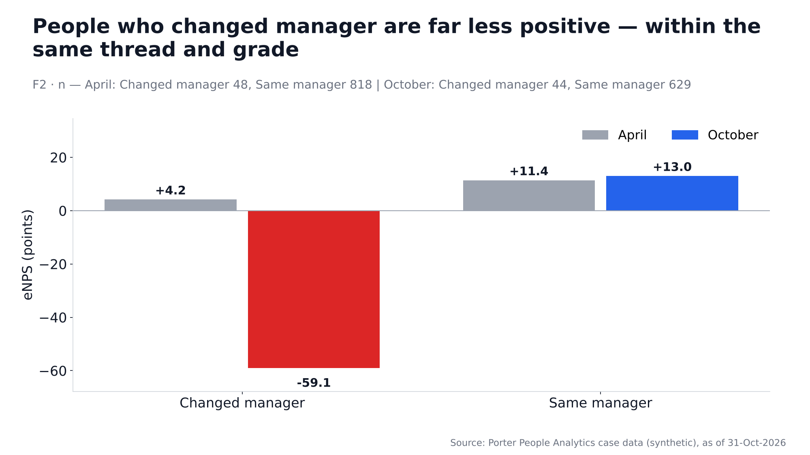

### F2b — New joiners start negative, and onboarding (Q5) is the weak point

*Hypothesis 2b · Sentiment · Verdict: **Supported***

**Finding.** New joiners on their first manager scored October eNPS -23.8 (n = 126) vs +13.0 for same-manager employees (n = 629), and only 10.3% rated onboarding/tools (Q5) favourably vs 47.9%.

| Group | Value | n |
|---|---|---|
| New joiner (first manager): eNPS Oct | -23.8 | 126 |
| Same manager: eNPS Oct | +13.0 | 629 |
| New joiner: Q5 mean / % favourable | 2.19 / 10.3% | 126 |
| Same manager: Q5 mean / % favourable | 3.34 / 47.9% | 629 |
| New joiners in Intercity: eNPS Oct | -52.6 | 38 |
| New joiners elsewhere: eNPS Oct | -11.4 | 88 |

**Test.** eNPS: z-test, significant (p < 0.001). Q5: Mann-Whitney, significant (p < 0.001).

**Caveat.** New joiners are also the <6-month tenure group (F6, F19), so this is largely the same signal seen three ways. Intercity new joiners are much lower than new joiners elsewhere (n shown) — it overlaps with the Intercity reorg.

**So what / action.** Fix onboarding for the first 90 days (tools ready on day 1, buddy, 30/60/90 check-ins); measure Q5 for joiners next wave.

### F3 — Intercity is the weakest thread, and its fall comes from the manager-change and new-joiner groups

*Hypothesis 3 · Sentiment · Verdict: **Supported***

**Finding.** Intercity had the lowest October eNPS (-19.4, n = 186) vs +10.1 for the rest of the company (n = 613); if its changed-manager and new-joiner respondents had scored like its same-manager respondents, Intercity would be +9.6.

| Group | Value | n |
|---|---|---|
| Intercity, October | -19.4 | 186 |
| Geo Expansion, October | -0.9 | 110 |
| Central, October | +0.8 | 118 |
| Intracity, October | +9.8 | 275 |
| Enterprise, October | +23.1 | 26 |
| Packers & Movers, October | +34.5 | 84 |
| Intercity, April | +0.0 | 170 |

**Test.** Intercity vs rest of company (October): z-test, significant (p < 0.001).

**Caveat.** Thread is the current thread (no attribute history). The counterfactual assumes the affected people would have scored like same-manager colleagues in the same thread — an upper bound on what fixing the transition could do.

**So what / action.** Focus the Intercity response on the June reorg and the onboarding of its new joiners, not a thread-wide programme (see F3a, F3b).

### F3a — Intercity without the reorganised teams looks like the rest of the company

*Hypothesis 3a · Sentiment · Verdict: **Supported** · **Deck candidate***

**Finding.** Intercity's same-manager respondents scored +9.6 in October (n = 104), close to same-manager respondents elsewhere (+13.7, n = 525) and up from -1.6 in April; the thread's fall comes from the changed-manager (-59.1, n = 44) and new-joiner (-52.6, n = 38) groups.

| Group | Value | n |
|---|---|---|
| Intercity — Changed manager | Apr +4.2 → Oct -59.1 | 48 / 44 |
| Intercity — New joiner (first manager) | Apr — → Oct -52.6 | 0 / 38 |
| Intercity — Same manager | Apr -1.6 → Oct +9.6 | 122 / 104 |
| Intercity excluding changed-manager respondents, Oct | -7.0 | 142 |
| Rest of company, Oct | +10.1 | 613 |
| Rest of company, same manager, Oct | +13.7 | 525 |

**Test.** Intercity same manager vs same manager elsewhere: z-test, **NOT significant** (p = 0.65) — no detectable difference. Intercity excluding the 44 changed-manager respondents vs the rest of the company: significant (p = 0.03) (the remaining gap is the Intercity new joiners).

**Caveat.** n per cell is shown (April / October). Not significant here means no evidence of a difference, not proof of equality; the Intercity same-manager group is n = 104.

**So what / action.** Do not run a thread-wide Intercity intervention; target the reorganised teams and Intercity onboarding.

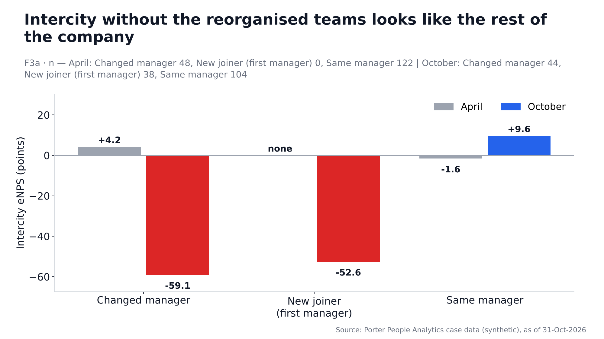

### F3b — The Intercity manager changes were one reorganisation in June, onto two managers

*Hypothesis 3b · Sentiment · Verdict: **Supported (descriptive)***

**Finding.** All 62 Intercity manager changes took effect between 01-Jun and 20-Jun-2026, and 61 of them moved to just two managers (out of 3 distinct new managers) — a team restructure, not normal churn; those two managers also took on 17 of the 48 Intercity new joiners.

| Group | Value | n |
|---|---|---|
| Apr-2026 | 0 |  |
| May-2026 | 0 |  |
| Jun-2026 | 62 |  |
| Jul-2026 | 0 |  |
| Aug-2026 | 0 |  |
| Sep-2026 | 0 |  |
| Oct-2026 | 0 |  |
| Distinct new managers | 3 | 62 |
| Moved to the two largest receiving managers (Manager A, Manager B) | 61 | 62 |
| Intercity new joiners placed under Manager A or B | 17 | 48 |
| Current team size of Manager A + B (all statuses) | 86 |  |

**Test.** Descriptive (employee-level HRMS data; no survey data and no names joined). Manager IDs are not shown.

**Caveat.** Only the current manager is recorded: earlier moves in the window, or people who moved and then exited, are not visible.

**So what / action.** Run a structured review of the June Intercity reorganisation with Manager A and Manager B: team size, span of control and how the transition was communicated.

### F4 — Fix manager feedback first: it matters most among the low-scoring drivers

*Hypothesis 4 · Sentiment · Verdict: **Supported** · **Deck candidate***

**Finding.** Q2 manager feedback has the strongest link with recommending Porter among the below-median drivers (Spearman ρ = 0.65, n = 796) and an October mean of 3.11 / 5 (April 3.31); it is also the most important driver overall. In comments, Manager rose from 9.6% to 16.7% of themed comments and Onboarding from 10.7% to 17.6%, while Positive fell from 37.6% to 24.0% (comments n = 271 / 233).

| Group | Value | n |
|---|---|---|
| Q2 manager feedback | ρ 0.65 · mean Oct 3.11 (Apr 3.31) · 39.4% fav | 796 |
| Q6 growth path | ρ 0.63 · mean Oct 3.13 (Apr 3.22) · 38.5% fav | 792 |
| Q5 onboarding/tools | ρ 0.62 · mean Oct 3.13 (Apr 3.24) · 40.7% fav | 798 |
| Q4 workload | ρ 0.61 · mean Oct 3.10 (Apr 3.12) · 36.0% fav | 795 |
| Q3 fair pay | ρ 0.59 · mean Oct 3.01 (Apr 3.04) · 35.6% fav | 795 |
| Comment theme 'Positive': share of themed comments Apr → Oct | 37.6% → 24.0% | 271 / 233 |
| Comment theme 'Onboarding': share of themed comments Apr → Oct | 10.7% → 17.6% | 271 / 233 |
| Comment theme 'Manager': share of themed comments Apr → Oct | 9.6% → 16.7% | 271 / 233 |
| Comment theme 'Pay': share of themed comments Apr → Oct | 18.5% → 15.5% | 271 / 233 |
| Comment theme 'Workload': share of themed comments Apr → Oct | 12.5% → 13.3% | 271 / 233 |
| Comment theme 'Growth': share of themed comments Apr → Oct | 11.1% → 12.9% | 271 / 233 |

**Test.** Spearman correlations with Q1 (October): Q2 p < 0.001; Q6 p < 0.001; Q5 p < 0.001; Q4 p < 0.001; Q3 p < 0.001.

**Caveat.** Correlation is not causation, and drivers correlate with each other; importance here is a ranking aid. Uses October only. For the ranking score the correlation is converted to the d scale, which flatters this finding relative to group comparisons.

**So what / action.** Put manager feedback at the top of the action plan (it is what fell most for changed-manager teams, F2): manager training on regular feedback and 1:1s.

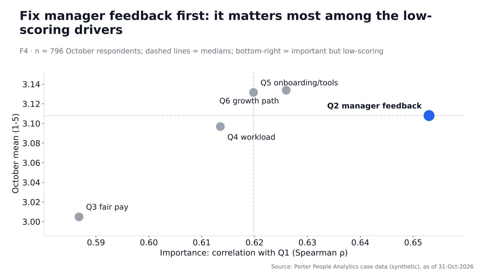

### F5 — Employees paid below 0.90 of band mid rate pay fairness far lower and recommend less

*Hypothesis 5 · Sentiment · Verdict: **Supported** · **Deck candidate***

**Finding.** Employees below 0.90 compa-ratio rated fair pay (Q3) 2.38 / 5 (17.0% favourable, n = 207) vs 3.23 (42.3%, n = 585) for those at or above band, and their eNPS was -7.7 vs +7.0.

| Group | Value | n |
|---|---|---|
| Below band (<0.90): Q3 mean / % fav | 2.38 / 17.0% | 207 |
| At or above band: Q3 mean / % fav | 3.23 / 42.3% | 585 |
| Below band: eNPS Oct | -7.7 | 207 |
| At or above: eNPS Oct | +7.0 | 585 |
| Below band: eNPS Apr | -6.2 | 260 |

**Test.** Q3: Mann-Whitney, significant (p < 0.001). eNPS: z-test, significant (p = 0.03).

**Caveat.** Compa band is from the current CTC and the 2026-04-01 band set; 7 monthly CTC values were corrected ×12. The gap was already there in April, so it is structural rather than new.

**So what / action.** Prioritise below-band employees (especially strong performers) in the next pay review; track Q3 for this group.

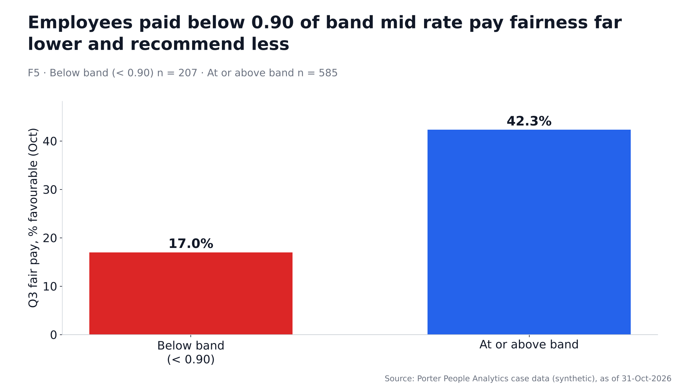

### F6 — Under-6-month employees rate onboarding lowest — in both waves

*Hypothesis 6 · Sentiment · Verdict: **Supported** · **Deck candidate***

**Finding.** In October, employees with under 6 months' tenure rated onboarding/tools (Q5) 2.15 / 5 (9.4% favourable, n = 139) vs 3.34 (47.3%, n = 660) for everyone else; April showed the same gap (16.8% vs 49.0%).

| Group | Value | n |
|---|---|---|
| <6m, Oct: Q5 mean / % fav | 2.15 / 9.4% | 139 |
| 6m+, Oct: Q5 mean / % fav | 3.34 / 47.3% | 660 |
| <6m, Apr: Q5 mean / % fav | 2.20 / 16.8% | 137 |
| 6m+, Apr: Q5 mean / % fav | 3.43 / 49.0% | 729 |
| <6m eNPS Oct | -27.3 | 139 |

**Test.** October: Mann-Whitney, significant (p < 0.001). April: significant (p < 0.001).

**Caveat.** Tenure band is at each wave's open date; the <6m groups are different people in each wave, so this is a persistent process gap, not one cohort.

**So what / action.** Same action as F2b: onboarding owner, day-1 readiness checklist, 30/60/90 check-ins.

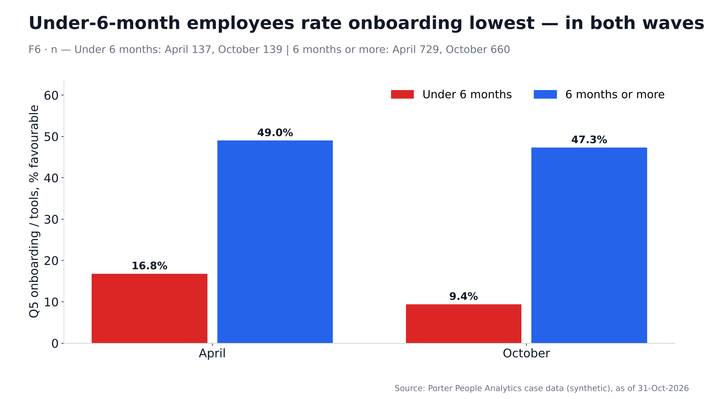

### F7 — April detractors left voluntarily at 6 times the rate of promoters

*Hypothesis 7 · Sentiment · Verdict: **Supported** · **Deck candidate***

**Finding.** 27.8% of April detractors left voluntarily by 31-Oct (n = 245) vs 5.0% of promoters (n = 340); regrettable exits were 21.2% vs 4.1%.

| Group | Value | n |
|---|---|---|
| Detractors: voluntary exit % | 27.8% | 245 |
| Passives: voluntary exit % | 10.0% | 281 |
| Promoters: voluntary exit % | 5.0% | 340 |
| Detractors: regrettable exit % | 21.2% | 245 |
| Promoters: regrettable exit % | 4.1% | 340 |

**Test.** Voluntary exits: two-proportion z-test, significant (p < 0.001). Regrettable exits: two-proportion z-test, significant (p < 0.001).

**Caveat.** About six months of follow-up; exit attributes are attached to survey rows before IDs are dropped, so this is anonymous. Being a detractor may reflect, not cause, an intention to leave.

**So what / action.** Use eNPS as an early-warning signal: teams with many detractors get a stay-interview round within a month of each wave.

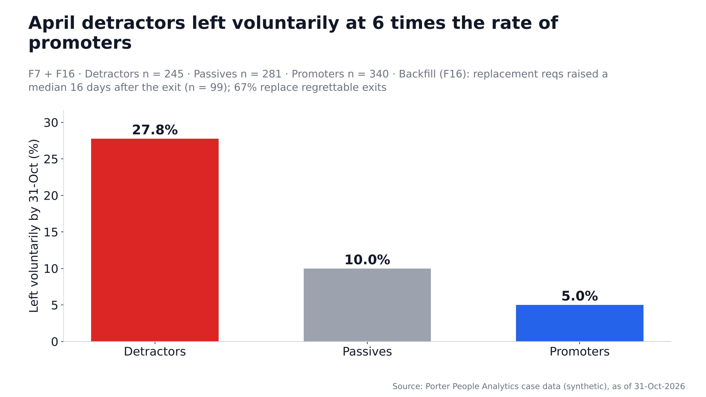

### F8 — Packers & Movers' rise came with a collapse in response rate — read it with caution

*Hypothesis 8 · Sentiment · Verdict: **Partly supported: response rates fell sharply; bias NOT significant** · **Deck candidate***

**Finding.** Packers & Movers' response rate fell from 80.1% to 45.9% and Enterprise's from 82.7% to 24.1%; in Packers & Movers the people who answered again in October had been happier in April (+44.9) than those who stopped answering (+19.4, a gap that is not significant), so its rise from +21.9 to +34.5 may partly reflect who answered rather than real improvement.

| Group | Value | n |
|---|---|---|
| Central: response rate Apr → Oct | 78.4% → 75.6% | 153 / 156 invited |
| Enterprise: response rate Apr → Oct | 82.7% → 24.1% | 110 / 108 invited |
| Geo Expansion: response rate Apr → Oct | 75.7% → 90.2% | 115 / 122 invited |
| Intercity: response rate Apr → Oct | 81.7% → 81.6% | 208 / 228 invited |
| Intracity: response rate Apr → Oct | 81.1% → 81.4% | 322 / 338 invited |
| Packers & Movers: response rate Apr → Oct | 80.1% → 45.9% | 171 / 183 invited |
| All: April eNPS of Oct non-respondents vs respondents | +15.9 vs +20.2 | 227 / 526 |
| Enterprise: April eNPS of Oct non-respondents vs respondents | +30.0 vs +41.2 | 60 / 17 |
| Packers & Movers: April eNPS of Oct non-respondents vs respondents | +19.4 vs +44.9 | 72 / 49 |

**Test.** Response-rate change, Packers & Movers: two-proportion z-test, significant (p < 0.001); Enterprise: two-proportion z-test, significant (p < 0.001). Non-response bias (April eNPS, non-respondents vs respondents): all **NOT significant** (p = 0.49); Packers & Movers **NOT significant** (p = 0.07); Enterprise **NOT significant** (p = 0.57).

**Caveat.** We only see April answers for October non-respondents; their October view is unknown. Enterprise October n is small (26).

**So what / action.** Before celebrating a thread's rise, check its response rate; set a 60% response-rate target per thread and send reminders through thread leads.

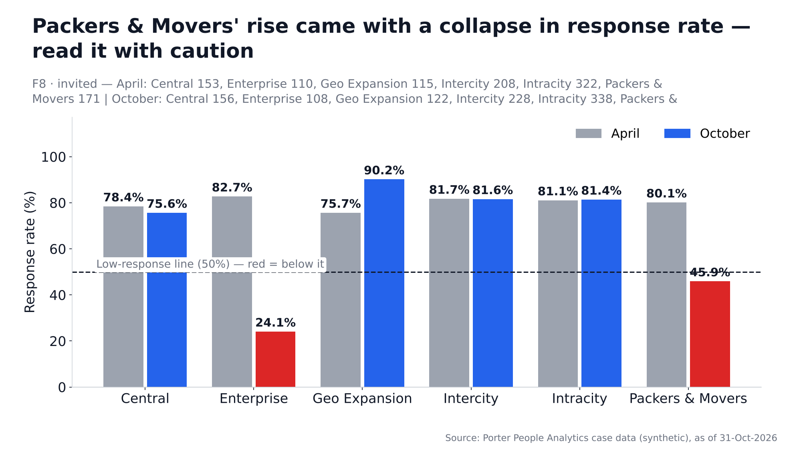

### F9 — Small segments are hidden (n<5), which protects anonymity but limits detail

*Hypothesis 9 · Sentiment · Verdict: **Supported (descriptive)***

**Finding.** In October, 3 single-dimension segments and 2 of 27 thread × function cells have fewer than 5 respondents and are shown as 'n<5' (e.g. Design & Research, n = 4).

| Group | Value | n |
|---|---|---|
| thread: segments with n<5 of 6 | 0 | — |
| function: segments with n<5 of 11 | 1 | Design & Research (4) |
| job_family: segments with n<5 of 2 | 0 | — |
| grade: segments with n<5 of 11 | 2 | G10 (1), G9 (4) |
| location: segments with n<5 of 11 | 0 | — |
| tenure_band: segments with n<5 of 5 | 0 | — |
| compa_band: segments with n<5 of 4 | 0 | — |
| manager_status: segments with n<5 of 3 | 0 | — |
| performance_rating: segments with n<5 of 6 | 0 | — |
| location_type: segments with n<5 of 2 | 0 | — |
| Thread × function cells with n<5 | 2 | of 27 cells |

**Test.** Descriptive (suppression rule n<5 applied in SQL and in Ask the Data).

**Caveat.** Suppression hides a group's score, not its people's existence; with response rates falling, more cells will drop below 5.

**So what / action.** Report small functions at a rolled-up level (job family or thread) rather than dropping them; raise response rates in small teams.

## Hiring

### F10 — Senior roles (G6+) breach SLA most; junior and mid roles mostly meet it

*Hypothesis 10 · Hiring · Verdict: **Supported***

**Finding.** 54.2% of G6+ fills breached the 60-day SLA (n = 24) vs 20.8% for G2-G5 (n = 207); the worst grade is G7 with 37.5% within SLA and a median TTF of 70 days vs 60 (n = 8).

| Group | Value | n |
|---|---|---|
| TBA: median TTF 20 d vs SLA 30 d | 100.0% within SLA | 34 |
| G1: median TTF 17 d vs SLA 30 d | 93.9% within SLA | 33 |
| G2: median TTF 16 d vs SLA 30 d | 97.1% within SLA | 34 |
| G3: median TTF 38 d vs SLA 45 d | 58.5% within SLA | 65 |
| G4: median TTF 38 d vs SLA 45 d | 63.6% within SLA | 22 |
| G5: median TTF 26 d vs SLA 45 d | 73.7% within SLA | 19 |
| G6: median TTF 83 d vs SLA 60 d | 38.5% within SLA | 13 |
| G7: median TTF 70 d vs SLA 60 d | 37.5% within SLA | 8 |
| G8: median TTF 27 d vs SLA 60 d | 100.0% within SLA | 3 |

**Test.** Breach rate G6+ vs G2-G5: two-proportion z-test, significant (p < 0.001).

**Caveat.** Filled reqs only (open reqs are F10's mirror: 37 of 61 open reqs are past SLA). Senior grades have few fills, so per-grade rates move a lot with one or two reqs.

**So what / action.** Give G6+ roles a dedicated senior-hiring track (pre-approved offer ranges, early search partner) or a realistic SLA; review every G6+ req at day 30.

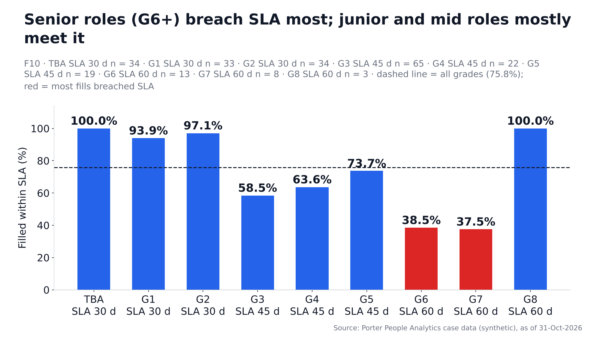

### F11 — Rhea Kapoor carries 35% of all reqs without a drop in speed — a concentration risk, not a performance problem

*Hypothesis 11 · Hiring · Verdict: **Partly supported: concentration yes, slower no***

**Finding.** Rhea Kapoor owns 106 of 300 reqs (35.3%); those fills took a median 23 days (n = 86) vs 26 for other recruiters (n = 145), with 76.7% vs 75.2% within SLA.

| Group | Value | n |
|---|---|---|
| Rhea Kapoor: reqs / filled % / median TTF | 106 / 81.1% / 23 d | 106 |
| Vikram Nair: reqs / filled % / median TTF | 44 / 72.7% / 26 d | 44 |
| Tanvi Joshi: reqs / filled % / median TTF | 35 / 82.9% / 25 d | 35 |
| Karan Bhat: reqs / filled % / median TTF | 32 / 84.4% / 20 d | 32 |
| Imran Sheikh: reqs / filled % / median TTF | 30 / 63.3% / 27 d | 30 |
| Divya Menon: reqs / filled % / median TTF | 28 / 71.4% / 52 d | 28 |
| Arnav Gupta: reqs / filled % / median TTF | 15 / 86.7% / 17 d | 15 |
| Meghna Rao: reqs / filled % / median TTF | 10 / 50.0% / 49 d | 10 |
| Rhea Kapoor: attainment (all accepted / excl. backed out) | 91.8% / 87.8% |  |

**Test.** TTF: Mann-Whitney, **NOT significant** (p = 0.26). Within SLA: two-proportion z-test, **NOT significant** (p = 0.79).

**Caveat.** Attainment depends on how many reqs a recruiter is given, so it is not a fair cross-recruiter comparison (the dashboard shows per-req measures). One person holding a third of the book is a continuity risk.

**So what / action.** Rebalance new reqs so no recruiter holds more than ~25%, and set targets per assigned req rather than per month.

### F12 — Two slow R1 interviewers lose candidates: every post-R1 withdrawal sits with them

*Hypothesis 12 · Hiring · Verdict: **Supported** · **Deck candidate***

**Finding.** Interviewer A (Engineering, G5) (median 12 days, n = 13) and Interviewer B (Engineering, G6) (median 10 days, n = 11) take far longer than the company median of 1 day to submit R1 feedback, and 13 of their 37 R1 candidates (35.1%) withdrew vs 0 of 1124 (0.0%) for every other interviewer.

| Group | Value | n |
|---|---|---|
| Interviewer A (Engineering, G5): median feedback days | 12 | 13 |
| Interviewer B (Engineering, G6): median feedback days | 10 | 11 |
| Interviewer A (Engineering, G5): R1 candidates who withdrew | 5 (27.8%) | 18 |
| Interviewer B (Engineering, G6): R1 candidates who withdrew | 8 (42.1%) | 19 |
| All other interviewers (≥5 interviews): median of medians | 1.0 | 1111 |
| R1 candidates who withdrew — slow interviewers | 13 (35.1%) | 37 |
| R1 candidates who withdrew — everyone else | 0 (0.0%) | 1124 |
| Filled reqs whose hire was R1-interviewed by them | 4 |  |
| Candidates still waiting for their R1 feedback on open reqs | 7 | 5 reqs |

**Test.** Withdrawals: Fisher exact, significant (p < 0.001). TTF counterfactual: see the counterfactual section (4 filled reqs, too few for a test).

**Caveat.** Withdrawal is a candidate status, not a reason code; the link is strong but other factors on those reqs may contribute. Names appear here because this is hiring data only (never joined to survey data).

**So what / action.** Set a 48-hour R1 feedback rule with an automatic reminder and escalation to the hiring manager; reassign pending candidates from these two interviewers now.

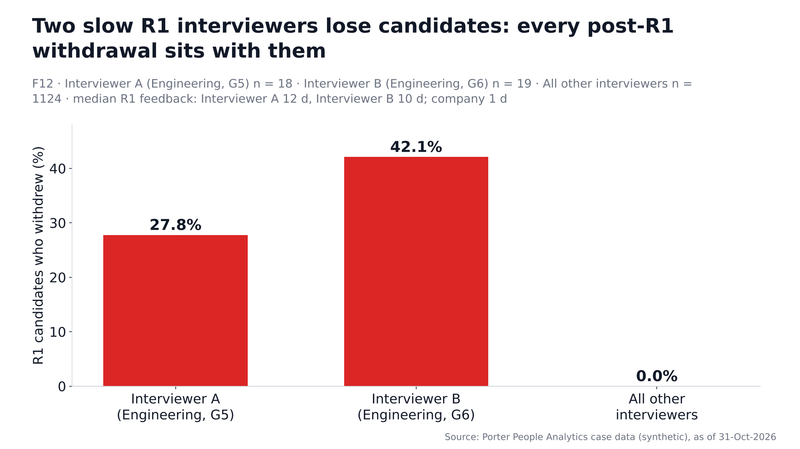

### F13 — Offers below 0.90× the candidate's expectation are declined 5 times as often — and 59 of 75 had budget headroom

*Hypothesis 13 · Hiring · Verdict: **Supported** · **Deck candidate***

**Finding.** 42.7% of offers below 0.90× expected CTC were declined (n = 75) vs 8.6% at 0.90× or more (n = 221); 59 of those 75 low offers could have been raised to 0.90× within the req's budgeted maximum, and offers sit at a median 0.82× of budget max.

| Group | Value | n |
|---|---|---|
| Offered ÷ expected <0.90: decline rate | 42.7% | 75 |
| Offered ÷ expected 0.90-0.99: decline rate | 7.7% | 142 |
| Offered ÷ expected 1.00-1.09: decline rate | 10.1% | 79 |
| Low offers (<0.90) that fit budget at 0.90× | 59 | 75 |
| Extra annual CTC to lift those offers to 0.90× | ₹8.87 lakh | 59 |

**Test.** Below vs at/above 0.90: two-proportion z-test, significant (p < 0.001).

**Caveat.** Declined offers may also reflect counter-offers or role fit; expected CTC is self-reported. The cost estimate is annual CTC for the offers that fit budget.

**So what / action.** Set an offer floor of 0.90× expected CTC whenever the budget allows; require TA Head sign-off for lower offers.

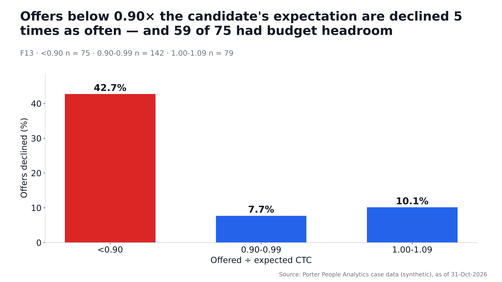

### F14 — Agency is the costliest and least reliable source; referrals and internal moves convert best

*Hypothesis 14 · Hiring · Verdict: **Supported***

**Finding.** Agency candidates accepted 64.0% of offers (n = 50) vs 86.6% for all other sources (n = 246), and converted applicant → hire at 1.68% (n = 1729) vs 10.85% for referrals (n = 857).

| Group | Value | n |
|---|---|---|
| Agency: applicant→hire / acceptance / median TTF | 1.68% / 64.0% / 26 d | 1729 |
| Naukri: applicant→hire / acceptance / median TTF | 2.94% / 82.8% / 24 d | 1702 |
| Employee Referral: applicant→hire / acceptance / median TTF | 10.85% / 87.4% / 23 d | 857 |
| Careers Page: applicant→hire / acceptance / median TTF | 2.02% / 75.0% / 26 d | 594 |
| LinkedIn: applicant→hire / acceptance / median TTF | 3.11% / 90.9% / 34 d | 578 |
| Internal (IJP): applicant→hire / acceptance / median TTF | 9.76% / 93.9% / 25 d | 297 |
| Agency fees per joiner | ₹44,839 | 18 |

**Test.** Offer acceptance, agency vs others: two-proportion z-test, significant (p < 0.001). Applicant → hire, agency vs referral: two-proportion z-test, significant (p < 0.001).

**Caveat.** Role mix is not controlled: if agencies are used for harder roles, part of the gap is the role, not the source. Acceptance is per offer; applicant → hire is per applicant. Agency fee = 8.33% of offered CTC, charged for agency joiners only.

**So what / action.** Expand the referral programme (bonus, internal job posts first) and use agencies only for roles referrals and internal moves cannot fill.

### F15 — The ATS overstates SLA performance: 14 filled reqs marked 'Within SLA' actually breached

*Hypothesis 15 · Hiring · Verdict: **Supported***

**Finding.** The system marks 81.8% of filled reqs within SLA vs 75.8% when recomputed from dates (n = 231); all 14 disagreements go the same way (system 'Within SLA', actually 2-86 days over).

| Group | Value | n |
|---|---|---|
| System: within SLA | 81.8% | 231 |
| Recomputed from dates: within SLA | 75.8% | 231 |
| Disagreements (all 'Within SLA' → breached) | 14 | 231 |
| Days over SLA on those reqs (min-median-max) | 2 - 23 - 86 | 14 |

**Test.** Exact McNemar (sign) test on the 14 discordant pairs, all in one direction: significant (p < 0.001).

**Caveat.** The ATS rule is unknown (no other date explains the 14); recomputed status is used everywhere in the dashboard.

**So what / action.** Fix the ATS SLA rule (or report from recomputed dates) before SLA numbers go to leadership.

### F16 — Backfills start a median 16 days after an exit, and 67% replace regrettable exits

*Hypothesis 16 · Hiring · Verdict: **Supported (lag); no difference by regrettable status** · **Deck candidate***

**Finding.** Replacement reqs were raised a median 16 days after the exit (n = 99); 66 of them (66.7%) replace regrettable exits, and 22 were raised before the person left.

| Group | Value | n |
|---|---|---|
| Median days exit → replacement req | 16 | 99 |
| Regrettable exits: median days | 16 | 66 |
| Non-regrettable exits: median days | 18 | 33 |
| Raised before the exit date | 22 | 99 |

**Test.** Lag, regrettable vs non-regrettable: Mann-Whitney, **NOT significant** (p = 0.62).

**Caveat.** Only replacement reqs whose replaced employee is in the master with an exit date are included.

**So what / action.** Start backfills at resignation (notice period), not at exit — especially for regrettable leavers.

### F20 — Where the days go: for G6+ roles the eventual hire applies 40 days after the req is raised (vs 5 overall); interviews take only days

*Hypothesis 20 (added at review) · Hiring · Verdict: **Supported** · **Deck candidate***

**Finding.** For filled reqs every stage takes a median of 2-5 days (n = 229-231 hires), the longest being Req raised → applied; for G6+ roles the biggest extra delay vs G2-G5 is at Req raised → applied (40 vs 4 days, n = 24 G6+ hires), while the interview stages take only a few days each.

| Group | Value | n |
|---|---|---|
| Req raised → applied | all 5 d · G6+ 40 d (G2-G5 4 d) | 231 / 24 |
| Applied → shortlisted | all 2 d · G6+ 2 d (G2-G5 2 d) | 229 / 24 |
| Shortlisted → screening | all 3 d · G6+ 4 d (G2-G5 2 d) | 229 / 24 |
| Screening → R1 | all 3 d · G6+ 2 d (G2-G5 3 d) | 229 / 24 |
| R1 → R2 | all 4 d · G6+ 4 d (G2-G5 4 d) | 229 / 24 |
| R2 → offer | all 3 d · G6+ 7 d (G2-G5 3 d) | 229 / 24 |
| Offer → response | all 3 d · G6+ 3 d (G2-G5 3 d) | 229 / 24 |
| Median TTF, all filled / G6+ / G2-G5 | 25 / 68 / 24 d | 231 / 24 / 207 |

**Test.** G6+ vs G2-G5 at 'Req raised → applied': Mann-Whitney, significant (p < 0.001). Other stages: Applied → shortlisted p = 0.70; Shortlisted → screening p < 0.001; Screening → R1 p = 0.74; R1 → R2 p = 0.003; R2 → offer p < 0.001; Offer → response p = 0.70.

**Caveat.** Stage times use the hired candidate's dated stages only (R1 Select has no date, so R1 → R2 covers it); medians of stages do not add up to the median TTF. 'Req raised → applied' is when the eventual hire applied, i.e. sourcing time. G6+ has few hires, so its medians move with one or two reqs.

**So what / action.** Attack the longest stage first (Req raised → applied); for G6+ start sourcing before the req is approved and pre-agree offer ranges.

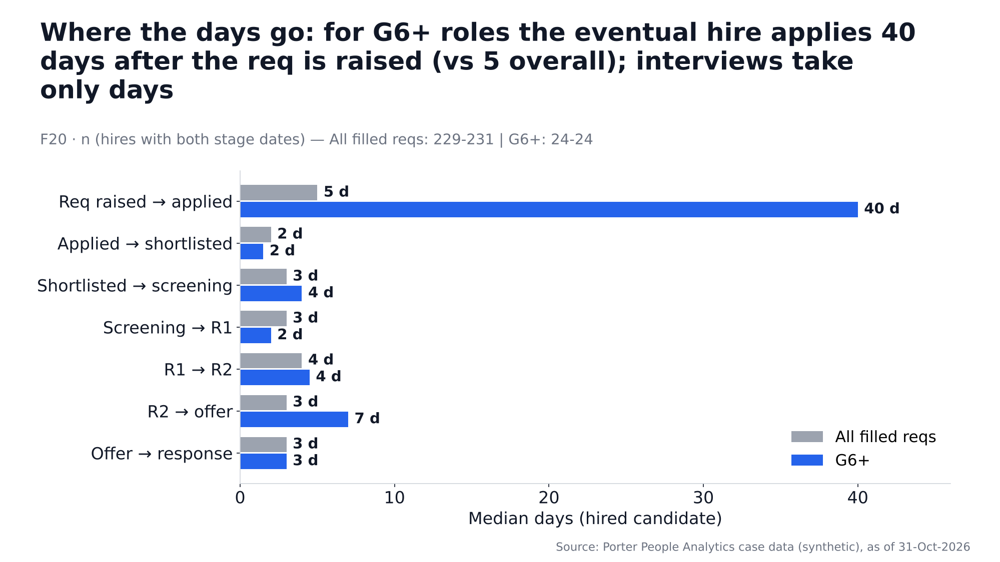

## Cross-dataset

### F17 — Lower-eNPS teams do not clearly raise more replacement reqs

*Hypothesis 17 · Cross-dataset · Verdict: **Not supported***

**Finding.** Across 22 thread × function teams with at least 10 respondents in each wave, April eNPS and replacement reqs per 100 employees are only weakly related (Spearman ρ = -0.04), and the eNPS change is also weakly related (ρ = -0.17).

| Group | Value | n |
|---|---|---|
| April eNPS vs replacement reqs per 100 heads | ρ = -0.04 | 22 |
| eNPS change vs replacement reqs per 100 heads | ρ = -0.17 | 22 |

**Test.** Spearman: April eNPS **NOT significant** (p = 0.87); change **NOT significant** (p = 0.44).

**Caveat.** Team-level (ecological) analysis with few teams; replacement reqs lag exits and depend on backfill policy. F7 (individual level) is the better test of the eNPS → exit link.

**So what / action.** No separate action; use F7 (detractor exits) as the retention signal.

### F18 — Interviewers and hiring managers do not report worse workload

*Hypothesis 18 · Cross-dataset · Verdict: **Not supported (opposite direction)***

**Finding.** Interviewers and hiring managers rated workload (Q4) 3.27 / 5 (40.7% favourable, n = 135) vs 3.06 (35.0%, n = 664) for everyone else — higher, not lower.

| Group | Value | n |
|---|---|---|
| Interviewers / hiring managers: Q4 mean / % fav | 3.27 / 40.7% | 135 |
| Everyone else: Q4 mean / % fav | 3.06 / 35.0% | 664 |
| Interviewers only | 3.47 | 43 |
| Hiring managers only | 3.22 | 115 |

**Test.** Mann-Whitney, significant (p = 0.04).

**Caveat.** Role flags come from People_Directory, attached before IDs are dropped (no names in survey data). The two slow interviewers (F12) cannot and should not be identified in survey data.

**So what / action.** No workload action for interviewers as a group; handle slow feedback through process (F12).

### F19 — This year's joiners rate onboarding far below everyone else

*Hypothesis 19 · Cross-dataset · Verdict: **Supported***

**Finding.** Employees who joined this financial year rated onboarding/tools (Q5) 2.20 / 5 (11.2% favourable, n = 143) in October vs 3.34 (47.2%, n = 656) for earlier joiners; their eNPS was -25.2.

| Group | Value | n |
|---|---|---|
| Joined this FY: Q5 mean / % fav | 2.20 / 11.2% | 143 |
| Earlier joiners: Q5 mean / % fav | 3.34 / 47.2% | 656 |
| Joined this FY: eNPS Oct | -25.2 | 143 |

**Test.** Mann-Whitney, significant (p < 0.001).

**Caveat.** Largely the same people as F2b (new joiners) and F6 (<6m tenure) — count it once in the deck.

**So what / action.** Same onboarding action as F2b; track Q5 for this FY's joiners in the next wave.
