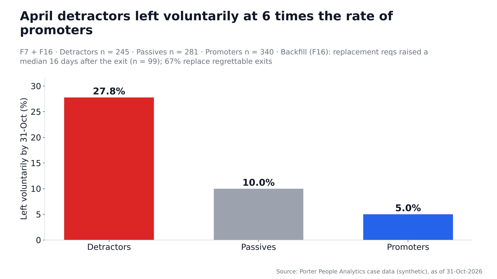

# Deck number trace

Every number on every slide of `docs/Porter_People_Insights.pptx` (headlines, text, drawings and speaker notes) with the line of `docs/insights.md` (slide 12: `docs/data_quality.md`) where the same value appears. Generated by `pipeline/06_build_deck.py`; the build stops if a number cannot be traced. Line numbers refer to the files as generated in the same run.

| Slide | Where | Number | Source | Line | Source text (start) |
|---|---|---|---|---|---|
| 2 | summary row | -59.1 | insights.md | 90 | **Finding.** October eNPS for people who changed manager was -59.1 (n = 44) vs +13.0 for those with the same manager (n = 629); within the s |
| 2 | summary row | 44 | insights.md | 90 | **Finding.** October eNPS for people who changed manager was -59.1 (n = 44) vs +13.0 for those with the same manager (n = 629); within the s |
| 2 | summary row | +13.0 | insights.md | 90 | **Finding.** October eNPS for people who changed manager was -59.1 (n = 44) vs +13.0 for those with the same manager (n = 629); within the s |
| 2 | summary row | 629 | insights.md | 90 | **Finding.** October eNPS for people who changed manager was -59.1 (n = 44) vs +13.0 for those with the same manager (n = 629); within the s |
| 2 | summary row | 9.4% | insights.md | 258 | **Finding.** In October, employees with under 6 months' tenure rated onboarding/tools (Q5) 2.15 / 5 (9.4% favourable, n = 139) vs 3.34 (47.3 |
| 2 | summary row | 6 | insights.md | 254 | ### F6 — Under-6-month employees rate onboarding lowest — in both waves |
| 2 | summary row | 139 | insights.md | 258 | **Finding.** In October, employees with under 6 months' tenure rated onboarding/tools (Q5) 2.15 / 5 (9.4% favourable, n = 139) vs 3.34 (47.3 |
| 2 | summary row | 47.3% | insights.md | 258 | **Finding.** In October, employees with under 6 months' tenure rated onboarding/tools (Q5) 2.15 / 5 (9.4% favourable, n = 139) vs 3.34 (47.3 |
| 2 | summary row | 660 | insights.md | 258 | **Finding.** In October, employees with under 6 months' tenure rated onboarding/tools (Q5) 2.15 / 5 (9.4% favourable, n = 139) vs 3.34 (47.3 |
| 2 | summary row | 27.8% | insights.md | 280 | **Finding.** 27.8% of April detractors left voluntarily by 31-Oct (n = 245) vs 5.0% of promoters (n = 340); regrettable exits were 21.2% vs  |
| 2 | summary row | 245 | insights.md | 280 | **Finding.** 27.8% of April detractors left voluntarily by 31-Oct (n = 245) vs 5.0% of promoters (n = 340); regrettable exits were 21.2% vs  |
| 2 | summary row | 5.0% | insights.md | 280 | **Finding.** 27.8% of April detractors left voluntarily by 31-Oct (n = 245) vs 5.0% of promoters (n = 340); regrettable exits were 21.2% vs  |
| 2 | summary row | 340 | insights.md | 280 | **Finding.** 27.8% of April detractors left voluntarily by 31-Oct (n = 245) vs 5.0% of promoters (n = 340); regrettable exits were 21.2% vs  |
| 2 | summary row | 40 | insights.md | 512 | ### F20 — Where the days go: for G6+ roles the eventual hire applies 40 days after the req is raised (vs 5 overall); interviews take only da |
| 2 | summary row | 24 | insights.md | 516 | **Finding.** For filled reqs every stage takes a median of 2-5 days (n = 229-231 hires), the longest being Req raised → applied; for G6+ rol |
| 2 | summary row | 4 | insights.md | 516 | **Finding.** For filled reqs every stage takes a median of 2-5 days (n = 229-231 hires), the longest being Req raised → applied; for G6+ rol |
| 2 | summary row | 13 | insights.md | 406 | **Finding.** Interviewer A (Engineering, G5) (median 12 days, n = 13) and Interviewer B (Engineering, G6) (median 10 days, n = 11) take far  |
| 2 | summary row | 37 | insights.md | 406 | **Finding.** Interviewer A (Engineering, G5) (median 12 days, n = 13) and Interviewer B (Engineering, G6) (median 10 days, n = 11) take far  |
| 2 | summary row | 0 | insights.md | 406 | **Finding.** Interviewer A (Engineering, G5) (median 12 days, n = 13) and Interviewer B (Engineering, G6) (median 10 days, n = 11) take far  |
| 2 | summary row | 1,124 | insights.md | 406 | **Finding.** Interviewer A (Engineering, G5) (median 12 days, n = 13) and Interviewer B (Engineering, G6) (median 10 days, n = 11) take far  |
| 2 | summary row | 42.7% | insights.md | 432 | **Finding.** 42.7% of offers below 0.90× expected CTC were declined (n = 75) vs 8.6% at 0.90× or more (n = 221); 59 of those 75 low offers c |
| 2 | summary row | 75 | insights.md | 428 | ### F13 — Offers below 0.90× the candidate's expectation are declined 5 times as often — and 59 of 75 had budget headroom |
| 2 | summary row | 8.6% | insights.md | 432 | **Finding.** 42.7% of offers below 0.90× expected CTC were declined (n = 75) vs 8.6% at 0.90× or more (n = 221); 59 of those 75 low offers c |
| 2 | summary row | 221 | insights.md | 432 | **Finding.** 42.7% of offers below 0.90× expected CTC were declined (n = 75) vs 8.6% at 0.90× or more (n = 221); 59 of those 75 low offers c |
| 2 | callout | +13.1 | insights.md | 41 | **Sentiment.** If the 44 changed-manager and 126 new-joiner October respondents had scored like same-manager respondents in their own thread |
| 2 | callout | +11.0 | insights.md | 41 | **Sentiment.** If the 44 changed-manager and 126 new-joiner October respondents had scored like same-manager respondents in their own thread |
| 3 | headline | 7.7 | insights.md | 67 | ### F1 — eNPS fell 7.7 points, also for the same people — but company-wide the fall is not statistically significant; it sits in specific gr |
| 3 | stat | +11.0 | insights.md | 71 | **Finding.** Company eNPS fell from +11.0 (n = 866) in April to +3.3 (n = 799) in October (-7.7 pts); among the 526 people who answered both |
| 3 | stat | +3.3 | insights.md | 71 | **Finding.** Company eNPS fell from +11.0 (n = 866) in April to +3.3 (n = 799) in October (-7.7 pts); among the 526 people who answered both |
| 3 | stat | 866 | insights.md | 71 | **Finding.** Company eNPS fell from +11.0 (n = 866) in April to +3.3 (n = 799) in October (-7.7 pts); among the 526 people who answered both |
| 3 | stat | 799 | insights.md | 71 | **Finding.** Company eNPS fell from +11.0 (n = 866) in April to +3.3 (n = 799) in October (-7.7 pts); among the 526 people who answered both |
| 3 | stat | +20.2 | insights.md | 71 | **Finding.** Company eNPS fell from +11.0 (n = 866) in April to +3.3 (n = 799) in October (-7.7 pts); among the 526 people who answered both |
| 3 | stat | +13.1 | insights.md | 71 | **Finding.** Company eNPS fell from +11.0 (n = 866) in April to +3.3 (n = 799) in October (-7.7 pts); among the 526 people who answered both |
| 3 | stat | 526 | insights.md | 71 | **Finding.** Company eNPS fell from +11.0 (n = 866) in April to +3.3 (n = 799) in October (-7.7 pts); among the 526 people who answered both |
| 3 | stat | 0.06 | insights.md | 80 | **Test.** All respondents: z-test on eNPS, **NOT significant** (p = 0.06). Panel: Wilcoxon signed-rank on the per-person Q1 change (mean -0. |
| 3 | drawing | -19 | insights.md | 137 | **Finding.** Intercity had the lowest October eNPS (-19.4, n = 186) vs +10.1 for the rest of the company (n = 613); if its changed-manager a |
| 3 | drawing | 186 | insights.md | 137 | **Finding.** Intercity had the lowest October eNPS (-19.4, n = 186) vs +10.1 for the rest of the company (n = 613); if its changed-manager a |
| 3 | drawing | -0.9 | insights.md | 142 | / Geo Expansion, October / -0.9 / 110 / |
| 3 | drawing | 110 | insights.md | 142 | / Geo Expansion, October / -0.9 / 110 / |
| 3 | drawing | +0.8 | insights.md | 143 | / Central, October / +0.8 / 118 / |
| 3 | drawing | 118 | insights.md | 143 | / Central, October / +0.8 / 118 / |
| 3 | drawing | +9.8 | insights.md | 144 | / Intracity, October / +9.8 / 275 / |
| 3 | drawing | 275 | insights.md | 144 | / Intracity, October / +9.8 / 275 / |
| 3 | drawing | +23 | insights.md | 145 | / Enterprise, October / +23.1 / 26 / |
| 3 | drawing | 26 | insights.md | 145 | / Enterprise, October / +23.1 / 26 / |
| 3 | drawing | +34 | insights.md | 146 | / Packers & Movers, October / +34.5 / 84 / |
| 3 | drawing | 84 | insights.md | 146 | / Packers & Movers, October / +34.5 / 84 / |
| 3 | drawing | 80.1% | insights.md | 302 | **Finding.** Packers & Movers' response rate fell from 80.1% to 45.9% and Enterprise's from 82.7% to 24.1%; in Packers & Movers the people w |
| 3 | drawing | 45.9% | insights.md | 302 | **Finding.** Packers & Movers' response rate fell from 80.1% to 45.9% and Enterprise's from 82.7% to 24.1%; in Packers & Movers the people w |
| 3 | speaker notes | +11.0 | insights.md | 71 | **Finding.** Company eNPS fell from +11.0 (n = 866) in April to +3.3 (n = 799) in October (-7.7 pts); among the 526 people who answered both |
| 3 | speaker notes | +3 | insights.md | 71 | **Finding.** Company eNPS fell from +11.0 (n = 866) in April to +3.3 (n = 799) in October (-7.7 pts); among the 526 people who answered both |
| 3 | speaker notes | 526 | insights.md | 71 | **Finding.** Company eNPS fell from +11.0 (n = 866) in April to +3.3 (n = 799) in October (-7.7 pts); among the 526 people who answered both |
| 3 | speaker notes | 0.06 | insights.md | 80 | **Test.** All respondents: z-test on eNPS, **NOT significant** (p = 0.06). Panel: Wilcoxon signed-rank on the per-person Q1 change (mean -0. |
| 3 | speaker notes | -19.4 | insights.md | 137 | **Finding.** Intercity had the lowest October eNPS (-19.4, n = 186) vs +10.1 for the rest of the company (n = 613); if its changed-manager a |
| 3 | speaker notes | 186 | insights.md | 137 | **Finding.** Intercity had the lowest October eNPS (-19.4, n = 186) vs +10.1 for the rest of the company (n = 613); if its changed-manager a |
| 4 | drawing | 61 | insights.md | 182 | **Finding.** All 62 Intercity manager changes took effect between 01-Jun and 20-Jun-2026, and 61 of them moved to just two managers (out of  |
| 4 | drawing | 62 | insights.md | 182 | **Finding.** All 62 Intercity manager changes took effect between 01-Jun and 20-Jun-2026, and 61 of them moved to just two managers (out of  |
| 4 | caption | 62 | insights.md | 182 | **Finding.** All 62 Intercity manager changes took effect between 01-Jun and 20-Jun-2026, and 61 of them moved to just two managers (out of  |
| 4 | drawing | -59 | insights.md | 159 | **Finding.** Intercity's same-manager respondents scored +9.6 in October (n = 104), close to same-manager respondents elsewhere (+13.7, n =  |
| 4 | drawing | +4 | insights.md | 163 | / Intercity — Changed manager / Apr +4.2 → Oct -59.1 / 48 / 44 / |
| 4 | drawing | 48 | insights.md | 163 | / Intercity — Changed manager / Apr +4.2 → Oct -59.1 / 48 / 44 / |
| 4 | drawing | 44 | insights.md | 159 | **Finding.** Intercity's same-manager respondents scored +9.6 in October (n = 104), close to same-manager respondents elsewhere (+13.7, n =  |
| 4 | drawing | -52.6 | insights.md | 159 | **Finding.** Intercity's same-manager respondents scored +9.6 in October (n = 104), close to same-manager respondents elsewhere (+13.7, n =  |
| 4 | drawing | 38 | insights.md | 159 | **Finding.** Intercity's same-manager respondents scored +9.6 in October (n = 104), close to same-manager respondents elsewhere (+13.7, n =  |
| 4 | drawing | +9.6 | insights.md | 159 | **Finding.** Intercity's same-manager respondents scored +9.6 in October (n = 104), close to same-manager respondents elsewhere (+13.7, n =  |
| 4 | drawing | -1.6 | insights.md | 159 | **Finding.** Intercity's same-manager respondents scored +9.6 in October (n = 104), close to same-manager respondents elsewhere (+13.7, n =  |
| 4 | drawing | 122 | insights.md | 165 | / Intercity — Same manager / Apr -1.6 → Oct +9.6 / 122 / 104 / |
| 4 | drawing | 104 | insights.md | 159 | **Finding.** Intercity's same-manager respondents scored +9.6 in October (n = 104), close to same-manager respondents elsewhere (+13.7, n =  |
| 4 | drawing | +13.7 | insights.md | 159 | **Finding.** Intercity's same-manager respondents scored +9.6 in October (n = 104), close to same-manager respondents elsewhere (+13.7, n =  |
| 4 | callout | 0.0% | insights.md | 101 | / Q2 manager feedback, % favourable Oct: Changed / 0.0% / 44 / |
| 4 | callout | 43.1% | insights.md | 102 | / Q2 manager feedback, % favourable Oct: Same / 43.1% / 629 / |
| 4 | speaker notes | 62 | insights.md | 182 | **Finding.** All 62 Intercity manager changes took effect between 01-Jun and 20-Jun-2026, and 61 of them moved to just two managers (out of  |
| 4 | speaker notes | 61 | insights.md | 182 | **Finding.** All 62 Intercity manager changes took effect between 01-Jun and 20-Jun-2026, and 61 of them moved to just two managers (out of  |
| 4 | speaker notes | +4.2 | insights.md | 163 | / Intercity — Changed manager / Apr +4.2 → Oct -59.1 / 48 / 44 / |
| 4 | speaker notes | -59.1 | insights.md | 159 | **Finding.** Intercity's same-manager respondents scored +9.6 in October (n = 104), close to same-manager respondents elsewhere (+13.7, n =  |
| 4 | speaker notes | +9.6 | insights.md | 159 | **Finding.** Intercity's same-manager respondents scored +9.6 in October (n = 104), close to same-manager respondents elsewhere (+13.7, n =  |
| 4 | speaker notes | +13.7 | insights.md | 159 | **Finding.** Intercity's same-manager respondents scored +9.6 in October (n = 104), close to same-manager respondents elsewhere (+13.7, n =  |
| 5 | drawing | 16.8% | insights.md | 258 | **Finding.** In October, employees with under 6 months' tenure rated onboarding/tools (Q5) 2.15 / 5 (9.4% favourable, n = 139) vs 3.34 (47.3 |
| 5 | drawing | 137 | insights.md | 264 | / <6m, Apr: Q5 mean / % fav / 2.20 / 16.8% / 137 / |
| 5 | drawing | 49.0% | insights.md | 258 | **Finding.** In October, employees with under 6 months' tenure rated onboarding/tools (Q5) 2.15 / 5 (9.4% favourable, n = 139) vs 3.34 (47.3 |
| 5 | drawing | 729 | insights.md | 265 | / 6m+, Apr: Q5 mean / % fav / 3.43 / 49.0% / 729 / |
| 5 | drawing | 9.4% | insights.md | 258 | **Finding.** In October, employees with under 6 months' tenure rated onboarding/tools (Q5) 2.15 / 5 (9.4% favourable, n = 139) vs 3.34 (47.3 |
| 5 | drawing | 139 | insights.md | 258 | **Finding.** In October, employees with under 6 months' tenure rated onboarding/tools (Q5) 2.15 / 5 (9.4% favourable, n = 139) vs 3.34 (47.3 |
| 5 | drawing | 47.3% | insights.md | 258 | **Finding.** In October, employees with under 6 months' tenure rated onboarding/tools (Q5) 2.15 / 5 (9.4% favourable, n = 139) vs 3.34 (47.3 |
| 5 | drawing | 660 | insights.md | 258 | **Finding.** In October, employees with under 6 months' tenure rated onboarding/tools (Q5) 2.15 / 5 (9.4% favourable, n = 139) vs 3.34 (47.3 |
| 5 | stat | -27.3 | insights.md | 266 | / <6m eNPS Oct / -27.3 / 139 / |
| 5 | stat | 6 | insights.md | 254 | ### F6 — Under-6-month employees rate onboarding lowest — in both waves |
| 5 | stat | 139 | insights.md | 258 | **Finding.** In October, employees with under 6 months' tenure rated onboarding/tools (Q5) 2.15 / 5 (9.4% favourable, n = 139) vs 3.34 (47.3 |
| 5 | stat | -23.8 | insights.md | 116 | **Finding.** New joiners on their first manager scored October eNPS -23.8 (n = 126) vs +13.0 for same-manager employees (n = 629), and only  |
| 5 | stat | 126 | insights.md | 116 | **Finding.** New joiners on their first manager scored October eNPS -23.8 (n = 126) vs +13.0 for same-manager employees (n = 629), and only  |
| 5 | stat | +13.0 | insights.md | 116 | **Finding.** New joiners on their first manager scored October eNPS -23.8 (n = 126) vs +13.0 for same-manager employees (n = 629), and only  |
| 5 | speaker notes | 6 | insights.md | 254 | ### F6 — Under-6-month employees rate onboarding lowest — in both waves |
| 5 | speaker notes | 16.8% | insights.md | 258 | **Finding.** In October, employees with under 6 months' tenure rated onboarding/tools (Q5) 2.15 / 5 (9.4% favourable, n = 139) vs 3.34 (47.3 |
| 5 | speaker notes | 49.0% | insights.md | 258 | **Finding.** In October, employees with under 6 months' tenure rated onboarding/tools (Q5) 2.15 / 5 (9.4% favourable, n = 139) vs 3.34 (47.3 |
| 5 | speaker notes | 9.4% | insights.md | 258 | **Finding.** In October, employees with under 6 months' tenure rated onboarding/tools (Q5) 2.15 / 5 (9.4% favourable, n = 139) vs 3.34 (47.3 |
| 5 | speaker notes | 47.3% | insights.md | 258 | **Finding.** In October, employees with under 6 months' tenure rated onboarding/tools (Q5) 2.15 / 5 (9.4% favourable, n = 139) vs 3.34 (47.3 |
| 6 | drawing | 0.65 | insights.md | 208 | **Finding.** Q2 manager feedback has the strongest link with recommending Porter among the below-median drivers (Spearman ρ = 0.65, n = 796) |
| 6 | caption | 796 | insights.md | 208 | **Finding.** Q2 manager feedback has the strongest link with recommending Porter among the below-median drivers (Spearman ρ = 0.65, n = 796) |
| 6 | drawing | 9.6% | insights.md | 208 | **Finding.** Q2 manager feedback has the strongest link with recommending Porter among the below-median drivers (Spearman ρ = 0.65, n = 796) |
| 6 | drawing | 16.7% | insights.md | 208 | **Finding.** Q2 manager feedback has the strongest link with recommending Porter among the below-median drivers (Spearman ρ = 0.65, n = 796) |
| 6 | drawing | 10.7% | insights.md | 208 | **Finding.** Q2 manager feedback has the strongest link with recommending Porter among the below-median drivers (Spearman ρ = 0.65, n = 796) |
| 6 | drawing | 17.6% | insights.md | 208 | **Finding.** Q2 manager feedback has the strongest link with recommending Porter among the below-median drivers (Spearman ρ = 0.65, n = 796) |
| 6 | drawing | 37.6% | insights.md | 208 | **Finding.** Q2 manager feedback has the strongest link with recommending Porter among the below-median drivers (Spearman ρ = 0.65, n = 796) |
| 6 | drawing | 24.0% | insights.md | 208 | **Finding.** Q2 manager feedback has the strongest link with recommending Porter among the below-median drivers (Spearman ρ = 0.65, n = 796) |
| 6 | caption | 271 | insights.md | 208 | **Finding.** Q2 manager feedback has the strongest link with recommending Porter among the below-median drivers (Spearman ρ = 0.65, n = 796) |
| 6 | caption | 233 | insights.md | 208 | **Finding.** Q2 manager feedback has the strongest link with recommending Porter among the below-median drivers (Spearman ρ = 0.65, n = 796) |
| 6 | callout | 0.90 | insights.md | 232 | ### F5 — Employees paid below 0.90 of band mid rate pay fairness far lower and recommend less |
| 6 | callout | 17.0% | insights.md | 236 | **Finding.** Employees below 0.90 compa-ratio rated fair pay (Q3) 2.38 / 5 (17.0% favourable, n = 207) vs 3.23 (42.3%, n = 585) for those at |
| 6 | callout | 207 | insights.md | 236 | **Finding.** Employees below 0.90 compa-ratio rated fair pay (Q3) 2.38 / 5 (17.0% favourable, n = 207) vs 3.23 (42.3%, n = 585) for those at |
| 6 | callout | 42.3% | insights.md | 236 | **Finding.** Employees below 0.90 compa-ratio rated fair pay (Q3) 2.38 / 5 (17.0% favourable, n = 207) vs 3.23 (42.3%, n = 585) for those at |
| 6 | callout | 585 | insights.md | 236 | **Finding.** Employees below 0.90 compa-ratio rated fair pay (Q3) 2.38 / 5 (17.0% favourable, n = 207) vs 3.23 (42.3%, n = 585) for those at |
| 6 | speaker notes | 0.65 | insights.md | 208 | **Finding.** Q2 manager feedback has the strongest link with recommending Porter among the below-median drivers (Spearman ρ = 0.65, n = 796) |
| 6 | speaker notes | 3.11 | insights.md | 208 | **Finding.** Q2 manager feedback has the strongest link with recommending Porter among the below-median drivers (Spearman ρ = 0.65, n = 796) |
| 6 | speaker notes | 9.6% | insights.md | 208 | **Finding.** Q2 manager feedback has the strongest link with recommending Porter among the below-median drivers (Spearman ρ = 0.65, n = 796) |
| 6 | speaker notes | 16.7% | insights.md | 208 | **Finding.** Q2 manager feedback has the strongest link with recommending Porter among the below-median drivers (Spearman ρ = 0.65, n = 796) |
| 7 | headline | 6 | insights.md | 276 | ### F7 — April detractors left voluntarily at 6 times the rate of promoters |
| 7 | drawing | 27.8% | insights.md | 280 | **Finding.** 27.8% of April detractors left voluntarily by 31-Oct (n = 245) vs 5.0% of promoters (n = 340); regrettable exits were 21.2% vs  |
| 7 | drawing | 245 | insights.md | 280 | **Finding.** 27.8% of April detractors left voluntarily by 31-Oct (n = 245) vs 5.0% of promoters (n = 340); regrettable exits were 21.2% vs  |
| 7 | drawing | 10.0% | insights.md | 285 | / Passives: voluntary exit % / 10.0% / 281 / |
| 7 | drawing | 281 | insights.md | 285 | / Passives: voluntary exit % / 10.0% / 281 / |
| 7 | drawing | 5.0% | insights.md | 280 | **Finding.** 27.8% of April detractors left voluntarily by 31-Oct (n = 245) vs 5.0% of promoters (n = 340); regrettable exits were 21.2% vs  |
| 7 | drawing | 340 | insights.md | 280 | **Finding.** 27.8% of April detractors left voluntarily by 31-Oct (n = 245) vs 5.0% of promoters (n = 340); regrettable exits were 21.2% vs  |
| 7 | drawing | 16 | insights.md | 491 | ### F16 — Backfills start a median 16 days after an exit, and 67% replace regrettable exits |
| 7 | drawing | 66.7% | insights.md | 495 | **Finding.** Replacement reqs were raised a median 16 days after the exit (n = 99); 66 of them (66.7%) replace regrettable exits, and 22 wer |
| 7 | drawing | 99 | insights.md | 495 | **Finding.** Replacement reqs were raised a median 16 days after the exit (n = 99); 66 of them (66.7%) replace regrettable exits, and 22 wer |
| 7 | drawing | 22 | insights.md | 495 | **Finding.** Replacement reqs were raised a median 16 days after the exit (n = 99); 66 of them (66.7%) replace regrettable exits, and 22 wer |
| 7 | drawing | 21.2% | insights.md | 280 | **Finding.** 27.8% of April detractors left voluntarily by 31-Oct (n = 245) vs 5.0% of promoters (n = 340); regrettable exits were 21.2% vs  |
| 7 | drawing | 4.1% | insights.md | 280 | **Finding.** 27.8% of April detractors left voluntarily by 31-Oct (n = 245) vs 5.0% of promoters (n = 340); regrettable exits were 21.2% vs  |
| 7 | speaker notes | 27.8% | insights.md | 280 | **Finding.** 27.8% of April detractors left voluntarily by 31-Oct (n = 245) vs 5.0% of promoters (n = 340); regrettable exits were 21.2% vs  |
| 7 | speaker notes | 5.0% | insights.md | 280 | **Finding.** 27.8% of April detractors left voluntarily by 31-Oct (n = 245) vs 5.0% of promoters (n = 340); regrettable exits were 21.2% vs  |
| 7 | speaker notes | 16 | insights.md | 296 |  |
| 7 | speaker notes | 99 | insights.md | 495 | **Finding.** Replacement reqs were raised a median 16 days after the exit (n = 99); 66 of them (66.7%) replace regrettable exits, and 22 wer |
| 8 | headline | 40 | insights.md | 512 | ### F20 — Where the days go: for G6+ roles the eventual hire applies 40 days after the req is raised (vs 5 overall); interviews take only da |
| 8 | stat | 54.2% | insights.md | 356 | **Finding.** 54.2% of G6+ fills breached the 60-day SLA (n = 24) vs 20.8% for G2-G5 (n = 207); the worst grade is G7 with 37.5% within SLA a |
| 8 | stat | 24 | insights.md | 356 | **Finding.** 54.2% of G6+ fills breached the 60-day SLA (n = 24) vs 20.8% for G2-G5 (n = 207); the worst grade is G7 with 37.5% within SLA a |
| 8 | stat | 20.8% | insights.md | 356 | **Finding.** 54.2% of G6+ fills breached the 60-day SLA (n = 24) vs 20.8% for G2-G5 (n = 207); the worst grade is G7 with 37.5% within SLA a |
| 8 | stat | 207 | insights.md | 356 | **Finding.** 54.2% of G6+ fills breached the 60-day SLA (n = 24) vs 20.8% for G2-G5 (n = 207); the worst grade is G7 with 37.5% within SLA a |
| 8 | stat | 68 | insights.md | 527 | / Median TTF, all filled / G6+ / G2-G5 / 25 / 68 / 24 d / 231 / 24 / 207 / |
| 8 | stat | 24 | insights.md | 516 | **Finding.** For filled reqs every stage takes a median of 2-5 days (n = 229-231 hires), the longest being Req raised → applied; for G6+ rol |
| 8 | stat | 14 | insights.md | 472 | ### F15 — The ATS overstates SLA performance: 14 filled reqs marked 'Within SLA' actually breached |
| 8 | drawing | 207 | insights.md | 527 | / Median TTF, all filled / G6+ / G2-G5 / 25 / 68 / 24 d / 231 / 24 / 207 / |
| 8 | drawing | 40 | insights.md | 512 | ### F20 — Where the days go: for G6+ roles the eventual hire applies 40 days after the req is raised (vs 5 overall); interviews take only da |
| 8 | drawing | 7 | insights.md | 525 | / R2 → offer / all 3 d · G6+ 7 d (G2-G5 3 d) / 229 / 24 / |
| 8 | drawing | 24 | insights.md | 516 | **Finding.** For filled reqs every stage takes a median of 2-5 days (n = 229-231 hires), the longest being Req raised → applied; for G6+ rol |
| 8 | speaker notes | 40 | insights.md | 512 | ### F20 — Where the days go: for G6+ roles the eventual hire applies 40 days after the req is raised (vs 5 overall); interviews take only da |
| 8 | speaker notes | 4 | insights.md | 516 | **Finding.** For filled reqs every stage takes a median of 2-5 days (n = 229-231 hires), the longest being Req raised → applied; for G6+ rol |
| 8 | speaker notes | 14 | insights.md | 472 | ### F15 — The ATS overstates SLA performance: 14 filled reqs marked 'Within SLA' actually breached |
| 9 | drawing | 12 | insights.md | 402 | ### F12 — Two slow R1 interviewers lose candidates: every post-R1 withdrawal sits with them |
| 9 | drawing | 13 | insights.md | 406 | **Finding.** Interviewer A (Engineering, G5) (median 12 days, n = 13) and Interviewer B (Engineering, G6) (median 10 days, n = 11) take far  |
| 9 | drawing | 10 | insights.md | 406 | **Finding.** Interviewer A (Engineering, G5) (median 12 days, n = 13) and Interviewer B (Engineering, G6) (median 10 days, n = 11) take far  |
| 9 | drawing | 11 | insights.md | 406 | **Finding.** Interviewer A (Engineering, G5) (median 12 days, n = 13) and Interviewer B (Engineering, G6) (median 10 days, n = 11) take far  |
| 9 | drawing | 13 | insights.md | 406 | **Finding.** Interviewer A (Engineering, G5) (median 12 days, n = 13) and Interviewer B (Engineering, G6) (median 10 days, n = 11) take far  |
| 9 | drawing | 37 | insights.md | 406 | **Finding.** Interviewer A (Engineering, G5) (median 12 days, n = 13) and Interviewer B (Engineering, G6) (median 10 days, n = 11) take far  |
| 9 | drawing | 0 | insights.md | 406 | **Finding.** Interviewer A (Engineering, G5) (median 12 days, n = 13) and Interviewer B (Engineering, G6) (median 10 days, n = 11) take far  |
| 9 | drawing | 1,124 | insights.md | 406 | **Finding.** Interviewer A (Engineering, G5) (median 12 days, n = 13) and Interviewer B (Engineering, G6) (median 10 days, n = 11) take far  |
| 9 | callout | 7 | insights.md | 418 | / Candidates still waiting for their R1 feedback on open reqs / 7 / 5 reqs / |
| 9 | callout | 5 | insights.md | 406 | **Finding.** Interviewer A (Engineering, G5) (median 12 days, n = 13) and Interviewer B (Engineering, G6) (median 10 days, n = 11) take far  |
| 9 | speaker notes | 5 | insights.md | 406 | **Finding.** Interviewer A (Engineering, G5) (median 12 days, n = 13) and Interviewer B (Engineering, G6) (median 10 days, n = 11) take far  |
| 9 | speaker notes | 1 | insights.md | 402 | ### F12 — Two slow R1 interviewers lose candidates: every post-R1 withdrawal sits with them |
| 9 | speaker notes | 13 | insights.md | 406 | **Finding.** Interviewer A (Engineering, G5) (median 12 days, n = 13) and Interviewer B (Engineering, G6) (median 10 days, n = 11) take far  |
| 9 | speaker notes | 37 | insights.md | 406 | **Finding.** Interviewer A (Engineering, G5) (median 12 days, n = 13) and Interviewer B (Engineering, G6) (median 10 days, n = 11) take far  |
| 9 | speaker notes | 0 | insights.md | 406 | **Finding.** Interviewer A (Engineering, G5) (median 12 days, n = 13) and Interviewer B (Engineering, G6) (median 10 days, n = 11) take far  |
| 9 | speaker notes | 1,124 | insights.md | 406 | **Finding.** Interviewer A (Engineering, G5) (median 12 days, n = 13) and Interviewer B (Engineering, G6) (median 10 days, n = 11) take far  |
| 9 | speaker notes | 35% | insights.md | 378 | ### F11 — Rhea Kapoor carries 35% of all reqs without a drop in speed — a concentration risk, not a performance problem |
| 10 | headline | 5 | insights.md | 428 | ### F13 — Offers below 0.90× the candidate's expectation are declined 5 times as often — and 59 of 75 had budget headroom |
| 10 | drawing | 42.7% | insights.md | 432 | **Finding.** 42.7% of offers below 0.90× expected CTC were declined (n = 75) vs 8.6% at 0.90× or more (n = 221); 59 of those 75 low offers c |
| 10 | drawing | 75 | insights.md | 428 | ### F13 — Offers below 0.90× the candidate's expectation are declined 5 times as often — and 59 of 75 had budget headroom |
| 10 | drawing | 7.7% | insights.md | 437 | / Offered ÷ expected 0.90-0.99: decline rate / 7.7% / 142 / |
| 10 | drawing | 142 | insights.md | 437 | / Offered ÷ expected 0.90-0.99: decline rate / 7.7% / 142 / |
| 10 | drawing | 10.1% | insights.md | 438 | / Offered ÷ expected 1.00-1.09: decline rate / 10.1% / 79 / |
| 10 | drawing | 79 | insights.md | 438 | / Offered ÷ expected 1.00-1.09: decline rate / 10.1% / 79 / |
| 10 | callout | 59 | insights.md | 428 | ### F13 — Offers below 0.90× the candidate's expectation are declined 5 times as often — and 59 of 75 had budget headroom |
| 10 | callout | 75 | insights.md | 428 | ### F13 — Offers below 0.90× the candidate's expectation are declined 5 times as often — and 59 of 75 had budget headroom |
| 10 | callout | ₹8.87 | insights.md | 440 | / Extra annual CTC to lift those offers to 0.90× / ₹8.87 lakh / 59 / |
| 10 | callout | 19 | insights.md | 41 | **Sentiment.** If the 44 changed-manager and 126 new-joiner October respondents had scored like same-manager respondents in their own thread |
| 10 | stat | 64.0% | insights.md | 454 | **Finding.** Agency candidates accepted 64.0% of offers (n = 50) vs 86.6% for all other sources (n = 246), and converted applicant → hire at |
| 10 | stat | 50 | insights.md | 454 | **Finding.** Agency candidates accepted 64.0% of offers (n = 50) vs 86.6% for all other sources (n = 246), and converted applicant → hire at |
| 10 | stat | 86.6% | insights.md | 454 | **Finding.** Agency candidates accepted 64.0% of offers (n = 50) vs 86.6% for all other sources (n = 246), and converted applicant → hire at |
| 10 | stat | 246 | insights.md | 454 | **Finding.** Agency candidates accepted 64.0% of offers (n = 50) vs 86.6% for all other sources (n = 246), and converted applicant → hire at |
| 10 | stat | ₹44,839 | insights.md | 464 | / Agency fees per joiner / ₹44,839 / 18 / |
| 10 | stat | 10.85% | insights.md | 454 | **Finding.** Agency candidates accepted 64.0% of offers (n = 50) vs 86.6% for all other sources (n = 246), and converted applicant → hire at |
| 10 | stat | 1.68% | insights.md | 454 | **Finding.** Agency candidates accepted 64.0% of offers (n = 50) vs 86.6% for all other sources (n = 246), and converted applicant → hire at |
| 10 | speaker notes | 59 | insights.md | 428 | ### F13 — Offers below 0.90× the candidate's expectation are declined 5 times as often — and 59 of 75 had budget headroom |
| 10 | speaker notes | 75 | insights.md | 428 | ### F13 — Offers below 0.90× the candidate's expectation are declined 5 times as often — and 59 of 75 had budget headroom |
| 10 | speaker notes | 0.90 | insights.md | 428 | ### F13 — Offers below 0.90× the candidate's expectation are declined 5 times as often — and 59 of 75 had budget headroom |
| 10 | speaker notes | 0.99 | insights.md | 437 | / Offered ÷ expected 0.90-0.99: decline rate / 7.7% / 142 / |
| 10 | speaker notes | 8.33% | insights.md | 468 | **Caveat.** Role mix is not controlled: if agencies are used for harder roles, part of the gap is the role, not the source. Acceptance is pe |
| 11 | recommendation 1 | +3.7 | insights.md | 55 | / 1 / Manager-transition playbook for the Intercity teams reorganised in June (HRBP check-in within 30 days, first 1:1 in week 1, skip-level |
| 11 | recommendation 1 | +16.3 | insights.md | 55 | / 1 / Manager-transition playbook for the Intercity teams reorganised in June (HRBP check-in within 30 days, first 1:1 in week 1, skip-level |
| 11 | recommendation 2 | 11.2% | insights.md | 56 | / 2 / 90-day onboarding standard: equipment and access on day 1, buddy, 30/60/90 check-ins, onboarding owner per thread / F2b, F6, F19 / CHR |
| 11 | recommendation 2 | +6.1 | insights.md | 56 | / 2 / 90-day onboarding standard: equipment and access on day 1, buddy, 30/60/90 check-ins, onboarding owner per thread / F2b, F6, F19 / CHR |
| 11 | recommendation 3 | 13 | insights.md | 57 | / 3 / 48-hour R1 feedback rule with auto-reminders and escalation; reassign the two slow interviewers' pending candidates now / F12 / TA Hea |
| 11 | recommendation 3 | 37 | insights.md | 57 | / 3 / 48-hour R1 feedback rule with auto-reminders and escalation; reassign the two slow interviewers' pending candidates now / F12 / TA Hea |
| 11 | recommendation 4 | 19 | insights.md | 56 | / 2 / 90-day onboarding standard: equipment and access on day 1, buddy, 30/60/90 check-ins, onboarding owner per thread / F2b, F6, F19 / CHR |
| 11 | recommendation 4 | ₹8.87 | insights.md | 58 | / 4 / Offer floor of 0.90× expected CTC when the req budget allows; sign-off for lower offers / F13 / TA Head / About 19 fewer declines for  |
| 11 | recommendation 5 | 45.8% | insights.md | 59 | / 5 / Senior-hiring track for G6+ and fix the ATS SLA rule so SLA reporting is accurate / F10, F15 / TA Head / G6+ within-SLA up from 45.8%; |
| 11 | speaker notes | 0.90 | insights.md | 58 | / 4 / Offer floor of 0.90× expected CTC when the req budget allows; sign-off for lower offers / F13 / TA Head / About 19 fewer declines for  |
| 11 | speaker notes | 0.99 | insights.md | 49 | **Hiring — offer floor.** 59 of the 75 offers below 0.90× expected CTC could have been raised to 0.90× within budget, for ₹8.87 lakh of extr |
| 12 | drawing | 1,726 | data_quality.md | 25 | Rows in → out: Employee_Master 1,322 → 1,310; eNPS_Responses 1,726 → 1,665. |
| 12 | drawing | 1,665 | data_quality.md | 25 | Rows in → out: Employee_Master 1,322 → 1,310; eNPS_Responses 1,726 → 1,665. |
| 12 | drawing | 1,322 | data_quality.md | 25 | Rows in → out: Employee_Master 1,322 → 1,310; eNPS_Responses 1,726 → 1,665. |
| 12 | drawing | 1,310 | data_quality.md | 25 | Rows in → out: Employee_Master 1,322 → 1,310; eNPS_Responses 1,726 → 1,665. |
| 12 | drawing | 5,815 | data_quality.md | 40 | Rows in → out: Candidates 5,815 → 5,757. |
| 12 | drawing | 5,757 | data_quality.md | 40 | Rows in → out: Candidates 5,815 → 5,757. |
| 12 | drawing | 14 | data_quality.md | 36 | / Accepted, then backed out / 14 / Not a hire / Req counted filled only if refilled / |
| 12 | caption | 116 | data_quality.md | 3 | Porter People Analytics case data, as of 31-Oct-2026. Every cleaning rule is logged in `data/clean/dq_log.csv` (116 rules; 71 changed data). |
